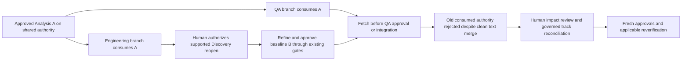

# Git-native publication and collaboration

[Documentation index](README.md) · [Workflow](workflow.md) · [Runtime authority](runtime-version-management.md)

This opt-in bridge uses native Git around the existing deterministic SDLC CLI. It
adds publication state, not a second lifecycle or approval framework. Without its
configuration the existing local workflow remains unchanged and never commits/pushes.
Human decisions, local persistence, commit, publication, integration and lifecycle
advancement remain separate. Git authorship does not authenticate a human decision.

## Configure deliberately at an adoption boundary

Keep the runtime outside the application. Use its retained Python interpreter and
`orchestrator/scripts/git_collaboration.py` (called `BRIDGE` below). In an existing
application with an initial commit, deliberately create and review `.sdlc-git.yaml`:

```yaml
schema_version: '0.1'
remote: origin
integration_branch: main
policy: direct
```

`remote` and `integration_branch` are configurable (`shared`, `master`, `develop`,
etc.). `direct` is only for repositories whose policy permits direct publication;
`pull_request` requires an explicitly selected proposal branch and external reviewed
integration. The bridge never changes hosting policy, opens/merges PRs or retries a
protected push through another route. A feature push is not integration.

Commit configuration through the repository's normal authorized process **before**
planning. It participates in the conservative application source boundary. Adding it
after Plan approval can legitimately require existing governed replanning; no scanner
exclusions or `.gitignore` tricks are introduced. Install a new committed runtime
explicitly, verify its resources, and use existing compatibility/promotion/session
mechanisms. Configured projects require `collaboration_contract: git-native/1`;
managed candidate runtimes without it cannot be selected for writes. A user deliberately
running an old unprotected executable or editing Git records is outside this local
procedural trust boundary. Server controls are required against such bypasses.

## One shared authority, separate workspaces

The configured remote integration branch is the **one** authoritative lifecycle.
Use short-lived branches such as `feature/REQ-0001-development` and
`feature/REQ-0001-qa`, with separate clones/worktrees for concurrent agents. Working
branches may contain implementation/test material; they cannot independently publish
request approvals or lifecycle authority. Do not share a checkout between writers.

At a new phase/workstream boundary inspect Git status and configured upstream. On a
clean integration checkout, `sync` fetches and fast-forwards only. It never stashes,
rebases, resets or merges feature work. On a feature branch, fetch and inspect upstream
explicitly; divergent work needs human impact review and existing track reconciliation.
Never pull unexpectedly in the middle of artifact creation or a human decision.

```bash
"$SDLC_PYTHON" "$BRIDGE" --project "$APP" status
"$SDLC_PYTHON" "$BRIDGE" --project "$APP" sync
```

Then read the existing stage review, approved upstream inputs and runtime/domain/template
pins. Read-only reviews need no commit. Their result is local, not a promise that the
remote has not changed. `epic.git_publication` makes that distinction explicit.

## Event-to-Git actions

These are operation names internal to the assistant, not additional `$sdlc` vocabulary.
The human still says review/approve/advance/start naturally. The assistant prepares the
exact CLI invocation, expected remote OID and bounded paths.

| Existing operation/event | Publication action |
| --- | --- |
| `new` | Allocate/create under lock; narrow to the actual new request; commit/publish request files |
| `discovery-update`, `discovery-complete`, `discovery-reopen` | Publish evidence or separately authorized completion/reopen; preserve all audit prefixes |
| `business-generate/revise`, `analysis-generate/revise` | Publish exact draft and history after existing validators pass |
| Business/Analysis `approve`, `request-changes`, `advance` | Separate revision-bound decision or separate advancement commit; never infer approval from a merge |
| `engineering-write/approve/request-changes/advance` | Publish the existing artifact/event baseline and metadata; no gate changes |
| `development-start` | Publish successful start before application edits; approval/advancement alone cannot start work |
| `qa-write/approve/request-changes/advance` | Publish independently owned QA state/artifacts; no implicit Engineering action |
| `check-run`, `qa-check-run` | Publish actual core-generated evidence with exact tested implementation commit trailer |
| `security-remediate`, `verification-remediate`, `engineering-finalize` | Publish authorized remediation/final verification evidence; retain source/QA joins |
| `assign`, `ownership-initialize`, `tracks-adopt`, `track-reconcile` | Publish explicit assignment/adoption/reconciliation; no automatic next-stage work |
| `runtime-bind`, `runtime-promote` | Publish the explicit future-work runtime decision, preserving its existing selection and authorization checks |
| Read-only `review/open/status/details/validate` | No mutation; an approved snapshot is already preserved by its approval operation |
| Development/QA work in progress (`publish`) | Only explicitly selected source/test files on a feature branch; never authoritative approval |

## Bridge request and publication contract

`run --request-file /outside/project/decision.json` accepts this strict JSON envelope:

```json
{
  "operation_id": "publish-business-decision-01",
  "expected_authority": "FULL_IMMUTABLE_REMOTE_COMMIT_OID",
  "request_id": "REQ-0001",
  "allowed_paths": ["requirements/REQ-0001-example"],
  "cli": ["business-approve", "REQ-0001", "...existing required CLI arguments..."]
}
```

Use actual full OIDs and real CLI arguments, not the example placeholders. The bridge
fetches and compares the remote before applying the operation, again inside the local
SDLC lock, and before pushing. The underlying CLI still checks its independent expected
revision, actual human wording/actor, uncertainty acknowledgement, source bindings and
lifecycle. No Git author/profile is inferred as the approver. New request envelopes use
`request_id: null` and `allowed_paths: ["requirements"]`; the bridge narrows this to the
returned request directory. Other envelopes require bounded request/QA paths. Input
files should live outside the project and are pinned for exact retries.

Optional `runtime_session` passes the existing verified session. Optional
`tested_commit` is a full local Git commit OID; it is **required** for check execution.
The bridge compares the application bytes/modes with that commit before and after
execution and before publication. Its `SDLC-Tested-Commit` commit trailer persists the
reference in Git, alongside existing actual check commands/results/source hashes.
The projection excludes governed `requirements/` and independent `qa/` material; it
**does not replace or weaken** the existing conservative source scanners or QA joins.
Tracked generated files that core source scanning excludes can cause a conservative
mismatch and must be reconciled, not silently excluded. A reference does not prove a
test ran or passed; the existing check evidence does that.

Only exact changed filenames within the authorized scopes are staged. The bridge
compares staged paths, Git blob OIDs and modes to recorded bytes, runs staged whitespace
checks, records the diff summary, and verifies the resulting commit's parent/path set.
Filters or hooks changing reviewed bytes fail closed. There is no `git add .`, automatic
force-add of ignored evidence, stash, reset, force push or conflict resolution.

`publish` accepts the same envelope **without `cli`**, with bounded application/QA file
paths, on a working branch. It never invokes SDLC operations or authorizes coding.
The operation's authority-base trailer is required by `integration-check --commit OID
--expected-authority OID`. That check fetches and rejects work consuming an older
lifecycle even when file edits do not conflict. It is read-only and does not authorize
or perform integration. Native integration needs a separately authorized review and
an expected-base server policy; check again immediately before it.

## Publication state and recovery

```text
prepared -> local_applied -> commit_pending -> committed -> push_pending
                                                        -> published (direct)
                                                        -> pr_pending (protected)
                                                        -> working_published (WIP)
pr_pending -> published only after confirm verifies external integration
failure -> rejected (no local change), operation_uncertain, or retained pending state
explicit human recovery -> abandoned (preserve files, commits and full journal)
```

Journals are private external bookkeeping at
`~/.local/share/ai-sdlc/git-operations/<checkout-key>/`, never authoritative SDLC
artifacts or a project checkpoint file. They store original intent, input pins,
correlation, exact paths/objects and append-only state entries. Commit trailers store
operation/event IDs and the authority base; a commit never embeds its own OID. The
receipt is written **after** retrieving the actual commit/ref. POSIX directory locks
serialize one checkout; remote non-fast-forward rejection serializes independent clones.
A repository-wide CAS is intentionally conservative: even disjoint remote events block
a stale decision rather than guessing semantic independence.

```bash
"$SDLC_PYTHON" "$BRIDGE" --project "$APP" recover --operation-id ORIGINAL_ID
"$SDLC_PYTHON" "$BRIDGE" --project "$APP" confirm --operation-id ORIGINAL_ID
```

Exact retry reuses the operation ID, CLI intent and input bytes. Successful commit but
failed push remains pending; never repeat the human decision with a new ID. Interrupted
commit recovery verifies its correlation trailer, parent and byte set; interrupted
successful direct push is recognized from the remote receipt. A closed publication
receipt is historical publication proof, **not** a fresh check of current authority.

Offline/authentication/hook/protection failures leave files/commits/index intact and
return structured diagnostics plus publication status where available. Inspect the
native failure privately (diagnostics do not echo possibly credentialed transport
stderr). Do not bypass an SDLC rejection, branch protection or stale checks. An uncertain
first `new` is deliberately not replayed: inspect the created ID/core outcome first.
Existing core `*-recover` operations may only restore the original inspected transaction.
Configured operations with ambiguous partial core journals deliberately stop: this bridge
does not yet compose those recovery commands inside its original guarded intent. They
require explicit maintenance support; never disable configuration or bypass a lock to
continue. Ordinary commit/push interruption recovery is implemented independently. An abandoned
lock requires inspection of the process; never remove another writer's lock blindly.

If safe recovery is impossible, `abandon --operation-id ID --actor NAME --decision
ACTUAL_WORDING` records an explicit external recovery decision and leaves **all** work
unchanged. Continue in a fresh clone from authoritative history with existing governed
reconciliation and fresh approvals; abandoning never rolls back or promotes a local
decision. Journal loss needs manual Git/audit reconciliation; no history is invented.

## Protected branches and integration

With `policy: pull_request`, `run` requires a proposal branch. Its local decision is
provisional until integration; the bridge blocks further writes in that checkout.
The remote integration branch stays authoritative, and returned state is `pr_pending`.
An external authorized PR process must enforce the reviewed expected authority base.
`confirm` accepts only the exact proposal commit (fast-forward), or a two-parent merge
whose first parent is the original authority and second parent the proposal; exact
request objects and implementation inputs must match. Intervening authority, changed
merge bytes, squash/rebase, or missing integration remains pending and requires review.
No hosting API or policy discovery is implemented. Config is a declared repository
policy; admins must actually enforce protections/expected-base checks on the server.
The bridge cannot prevent a separate unrestricted Git client from publishing invalid
metadata. After a confirmed merge, start a new proposal from fetched authority rather
than stacking state transitions on an obsolete branch. No automatic deletion/rebase.

## Git baseline references and legacy compatibility

New publication references are `(repository URL, full commit OID, request-local path,
event ID)`. Branch names and `HEAD` are not baseline IDs. Fetch/preserve the referenced
commit before reading. Retrieve exact bytes with `git show OID:path`, or:

```bash
"$SDLC_PYTHON" "$BRIDGE" --project "$APP" baseline \
  --commit FULL_OID --path requirements/REQ-0001-example/business.md \
  --event-id BD-0001 --compare
```

The command verifies a Git blob, committed event association and optional worktree
comparison. Approval references additionally require the selected artifact's blob to
occur in that approval's retained baseline (or its exact draft); metadata identifies
the decision itself. It reports `binding: event` for nonapproval events. It does not
certify current readiness, authenticate an actor, replace existing baseline/audit
validation, or retrospectively claim an imported legacy approval was made at the import
commit. Preserve existing validator results alongside this publication reference.

| Existing integrity mechanism | Treatment |
| --- | --- |
| Business/Analysis/Engineering/QA baseline SHA-256 IDs/manifests | Retained: existing readers, approval references and audit validation require them; no hashes removed or records rewritten |
| Source/evidence/revision digests | Retained: current stale-input checks and joins use these contracts independently of Git publication |
| Domain/template content/catalog pins | Retained: instruction selection and compatibility contracts remain version-bound |
| External runtime snapshot/package SHA-256 | Required: installed non-Git snapshots still need independent integrity checks |
| New Git publication references | Native Git commit/blob OIDs; no parallel artifact SHA field added |
| Old untracked/imported artifacts | Read unchanged; import commit is a preservation event, not invented historical approval provenance |

Removing parallel legacy hashes would require a separately approved format/reader
migration with equivalent proof for every consumer; it is deliberately excluded.
No historical baselines, pinned skills, templates or archived demo files are migrated.

## Upstream changes while Engineering and QA work



The implemented upstream route is governed Discovery reopening, not a new direct
Analysis rollback. Historical approvals/branches remain available. Existing track
reconciliation determines invalidated dependencies; Git never deletes work or declares
semantic consistency from a successful merge. No general workflow engine, automatic
agent concurrency, CI execution, notification, enterprise IAM or new lifecycle stage.

## Practical example: Engineering discovers a missing requirement

This is an illustrative operating procedure, not a fabricated acceptance transcript.
The configured integration branch may be `main`, `master`, `develop` or another reviewed
branch; replace the example workstream names with your project's conventions.

1. A human approves Functional Analysis A and separately authorizes advancement. Publish
   those events before dependent work; both work tracks consume the same approved A.
2. Engineering and QA use separate clean clones/worktrees and short-lived branches such
   as `feature/REQ-0001-development` and `feature/REQ-0001-qa`. Their selected source/test
   work can be published as working material, without independent lifecycle authority.
3. Engineering finds a consequential missing requirement. It preserves its code and
   requests clarification. Only an actual Requester decision authorizes the supported
   `discovery-reopen` route; there is no direct Analysis rollback command.
4. Publish the governed reopen against current remote authority. Existing decisions and
   branches remain historical evidence; downstream work cannot keep using A as current
   authority merely because its source files are unchanged.
5. Clarify the requirement through Discovery and the existing Business/Analysis gates.
   Preserve earlier revisions. Explicitly approve Analysis B and separately advance the
   new cycle; do not infer either decision from a successful Git merge.
6. QA may still have working tests derived from A. Before its approval, advancement or
   integration, fetch current authority. The old expected authority/consumed baseline
   must be rejected even if its files would merge without a textual conflict. A passing
   test of A is not current acceptance evidence for B.
7. Review impact and use existing eligible track reconciliation or prepare new-cycle
   outputs from authoritative B. Preserve useful old work, then renew the applicable
   approvals and source-bound checks before accepting QA evidence as current. Do not
   reassign people, reapprove unrelated stages or resolve merge conflicts silently.

Publication retries reuse the original intent. A rejected push does not authorize
changing a decision or rebasing metadata; preserve the pending commit and inspect
[recovery](#publication-state-and-recovery). Expected-base server policy is still needed
for external integration: a read-only check cannot eliminate a later integration race.

## Focused acceptance

Run the following from the orchestrator checkout:

```bash
.venv/bin/python -B -m unittest discover -s orchestrator/tests -p test_git_collaboration.py -v
```

 Fixtures use disposable
repositories, multiple clones, a local bare remote, fictional decisions and isolated
external journals. Authentication failure is injected; this is not an enterprise/hosted
PR acceptance claim. Then run the complete regression suite. For a real opt-in project,
review config at an adoption boundary, create a request with `run`, inspect its receipt
and exact Git blob, retry the same operation, and separately authorize completion or
approval/advancement. Never use historical demos as writeable test workspaces.


## Implementation verification — 2026-11-01

- Complete discovery-loaded regression suite: **506/506 passed**, run as two independent
  module groups using the existing `.venv` interpreter (`244` and `262` tests; both exit
  `0`). The final run took 893.315 seconds. Frozen-file checks verified unchanged scripts,
  tests, shared instructions, domain packages and templates throughout that run.
- Focused native Git suite: **30/30 passed**. Local bare remotes/multiple clones covered
  real Business approval and separate advancement, races, protected proposals, exact
  commit-object and byte references, literal filenames, second-request isolation,
  changed-source bindings, source-stale QA after reopening from Development, rejected
  pushes and interrupted receipts/commits with idempotent recovery.
- Standalone CLI smoke executed `run`, `baseline --compare`, `recover`, `open` and
  `validate` in an isolated application: matching remote commit receipt and clean
  working tree. All actors/decisions in automated fixtures were explicitly fictional;
  no real Product Owner approvals were simulated for an application.
- SHA-256 comparison with the pre-change inventory: **491 tracked demo files**, **61
  domain-package files**, **27 template files** and both host adapters unchanged. Existing
  approval/baseline/source validation modules and `.gitignore`/`.gitattributes` unchanged.
  Archived demonstration preservation tests also passed in the complete suite.
- Local Markdown link targets, whitespace checks and a candidate-file credential/large
  file scan passed. No dependencies, caches, identity profiles or application data are
  part of this implementation change.

Run the full suite with `.venv/bin/python -B -m unittest discover -s orchestrator/tests -v`.
The recorded run partitioned that same discovered suite by module into two isolated
processes and verified expected/executed counts plus the frozen-file inventory; it did
not replace, skip or mock regression tests. Earlier interrupted development runs are
not counted as completed suite evidence.

Remaining limits: local trusted POSIX tools, conservative repository-wide remote CAS,
external expected-base PR/server enforcement, manual impact/conflict reconciliation,
and the explicitly stopped ambiguous partial core-journal case above. Hosted PR and
enterprise authentication are not acceptance-tested. Existing installed runtimes and
request execution selections are not automatically updated by publishing this feature.
