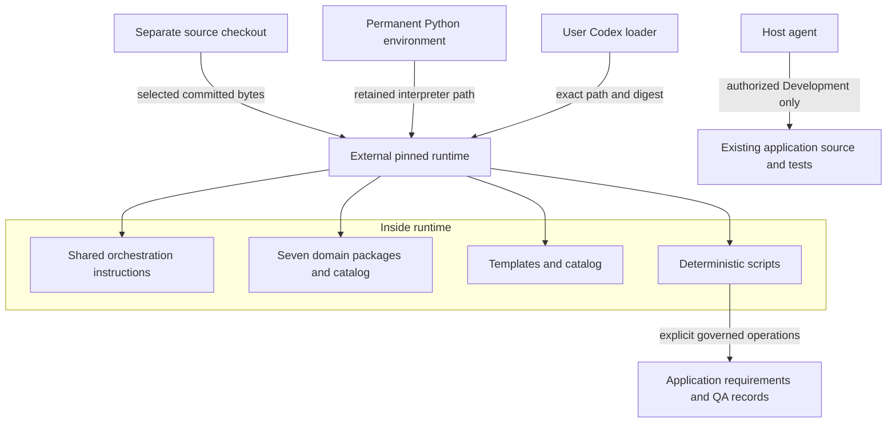
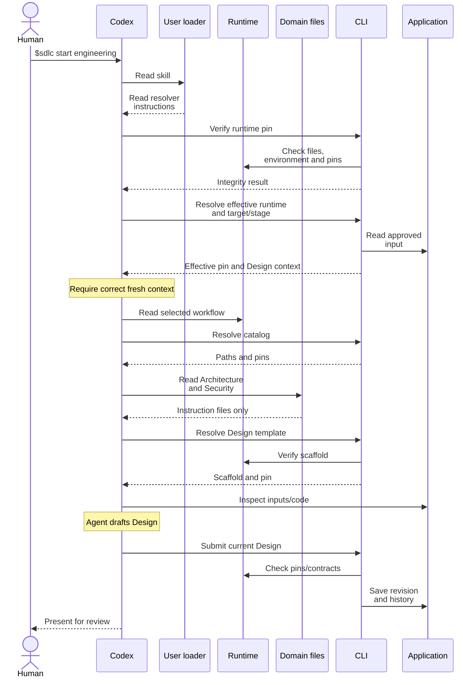
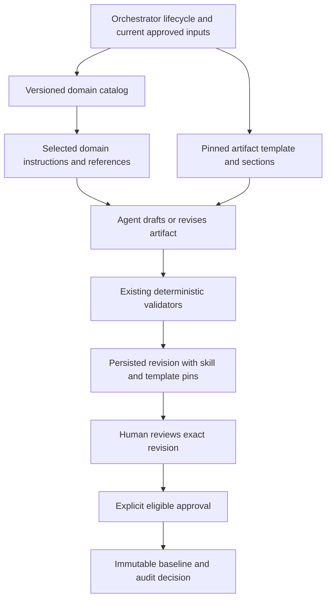
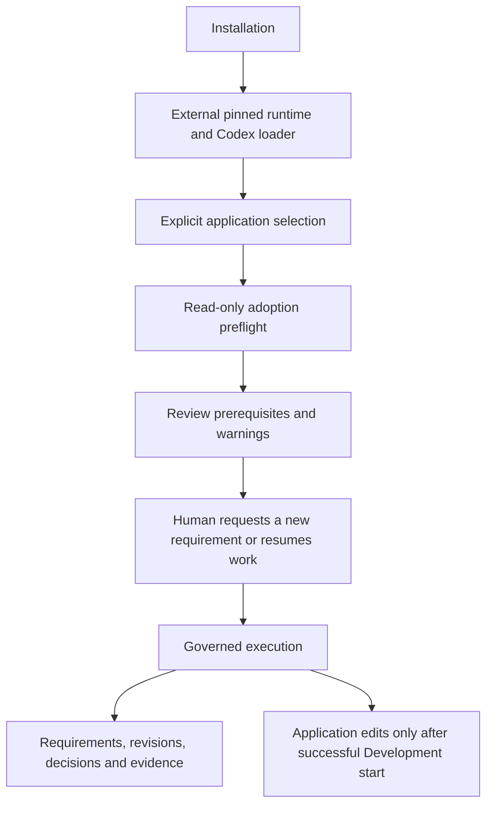

# Installation architecture: one entrypoint, a pinned runtime

[Documentation index](README.md) · [Getting started](getting-started.md) · [Installation commands and recovery](installation-and-adoption.md)

Install **one user-scoped SDLC skill loader**. It points to a complete runtime outside
any application repository. Discovery, Business Requirements, Functional Analysis, Architecture, Development, Testing and Security are bundled,
versioned instruction packages inside that runtime; this installer does not register
them as seven additional native Codex skills. The loader resolves a request/track's effective runtime separately from the selected
default; [runtime management](runtime-version-management.md) adds explicit update, rollback
and future-work promotion. The application keeps its existing code,
tests, instructions and Git history, then gains governed request artifacts during use.

## What lives where?

| Location | Contents and responsibility |
|---|---|
| Separate orchestrator source checkout | Source from which the selected Git revision is packaged. The default committed installation uses Git bytes, not uncommitted edits. |
| `~/.agents/skills/sdlc/` | Generated `SKILL.md` loader and `installation.json` containing the default runtime path/pin; managed registrations add resolver/history. This is the user-scoped Codex entrypoint. |
| `~/.local/share/ai-sdlc/runtimes/<revision-prefix>-<digest-prefix>/` | Complete selected execution resources plus its own `installation.json`. The actual directory uses the first 12 Git-revision characters and first 16 installation-digest characters. |
| `~/.local/share/ai-sdlc/venv/` | Recommended permanent Python environment created explicitly by the setup instructions. The installer does **not** create this venv or run pip; `--python` otherwise defaults to the invoking interpreter. |
| Existing application repository | Explicit target of adoption and later CLI operations, not an installation destination. Request records appear only after creation; application edits require the governed Development start. |
| External local identity profile | Declared name and informational roles, normally `~/.config/ai-sdlc/identity.json`; see [profile options](command-ux.md#local-profile). No credentials, verified identity or enforced RBAC. |

The runtime preserves the relative resource layout:

```text
<runtime>/
├── installation.json
├── README.md, docs/, .gitattributes
├── .agents/skills/sdlc/SKILL.md       # bundled checkout adapter, not another registration
├── .claude/skills/sdlc/SKILL.md       # bundled Claude adapter, not installed into Claude
└── orchestrator/
    ├── requirements.txt
    ├── scripts/                     # deterministic operations and validators
    ├── skill/                       # shared SKILL.md, commands.md, conversation.md
    ├── domain-skills/
    │   ├── catalog.yaml             # reviewed current version/content pins
    │   ├── discovery/, business-requirements/, functional-analysis/
    │   ├── architecture/            # manifest.yaml, SKILL.md, references/
    │   ├── development/
    │   ├── testing/
    │   ├── security/
    │   └── versions/<name>/<version>/ # retained historical package snapshots
    └── templates/
        ├── catalog.yaml
        └── versions/<id>/<version>/  # manifest.yaml and document.md
```

The execution bundle omits the contributor test suite, application examples and root
AGENTS.md. Keep the source checkout for contributor-only links and archive tools.
The absolute retained interpreter path participates in the installation pin; moving
or removing it can prevent verification/execution even if runtime files are unchanged.

This topology separates distribution from application work. The arrows show packaging,
references and managed writes, not automatic activity or a domain-agent pipeline.



## Why user scope? Can I use project scope?

User scope lets the same installed entrypoint serve different existing repositories
without copying orchestration resources or changing their project instructions. It
keeps runtime updates and installation metadata outside governed application source.
That separation also avoids making installer changes part of an application's approved
implementation fingerprint. It does not automatically exempt unrelated project files
from fingerprinting; `.gitignore` remains unrelated to source-bound approval integrity.

Codex itself supports both repository and user skill locations. Its native discovery
can expose the user registration across projects, subject to host configuration and
permissions. The installer writes the registration files; **it does not implement or
control Codex discovery**. The official [Codex skills documentation](https://learn.chatgpt.com/docs/build-skills)
describes these host scopes and explicit skill invocation.

This installer deliberately rejects a registration or runtime destination inside the
application **or any Git repository**. `--skill-root` changes the parent under which
`sdlc/` is created; it is not a project-install switch. `--runtime-root` changes the
parent for pinned runtime directories. Both are useful for isolated tests, but neither
makes an arbitrary directory discoverable to Codex. Normal use retains the standard
user skill root. A different root needs deliberate host discovery configuration/testing;
this installer does not set it up.

The repository's own `.agents/skills/sdlc/` adapter supports development with the complete
checkout. It is distinct from the generated installed loader. Copying that thin adapter
alone into an independent application's skill directory leaves its relative resources
missing. Adoption reports conflicting project/user/admin registrations rather than
restructuring them or merging instructions. Do not assume a project registration safely
shadows a user registration; resolve duplicate `sdlc` entries explicitly.

## What happens on `$sdlc status`?

1. **Host discovery:** Codex offers skill metadata and reads the selected native
   SKILL.md. `$sdlc status` is conversational input, not a shell command or native parser
   added by our installer.
2. **Loader:** registration metadata identifies the default and retained resolver manager;
   the runtime installation manifests bind exact paths, Git revision, preview flag,
   interpreter and payload digests. Legacy two-field registrations remain readable.
3. **Explicit target:** the agent resolves application/request/track from user/workspace
   context. It asks when ambiguous; the runtime directory is never the application.
4. **Verify and resolve:** using the pinned manager, the agent inspects/verifies the
   registration and runs runtime-status for that target. Default selection does not
   override an existing request/track pin. Missing/corrupt runtimes block work.
5. **Correct instructions:** the agent reads the effective snapshot's shared SKILL.md,
   commands.md and conversation.md. A conversation already carrying another runtime
   requires a fresh context before governed writes, not an assumed in-session reload.
6. **Read state:** the agent invokes read-only context/review operations from the resolved
   runtime. Bare downstream status can summarize both tracks; missing request context
   does not create one. No write receipt is needed merely to inspect state.
7. **Human result:** report stage, owner, current authority/evidence and next action.
   Status neither approves nor advances nor starts work.

The checks above are **loader instructions executed by the agent**, not a
Codex-enforced pre-execution hook or sandbox. New resolver guidance checks registration
as well as runtime authority. Historical loaders only instructed a runtime/environment
check, omitting `--skill-root`; explicit verification with that flag also validates
registration files. Managed writes now require the exact effective runtime and a
[context receipt](runtime-version-management.md#correct-runtime-before-correct-instructions).
An unrestricted editor can alter
the instruction to run the check; hashes do not authenticate people or prevent coordinated
rewriting. Host permissions remain the security boundary.

All seven packages and template pins are structurally checked during environment
verification. That does not mean their complete prose enters the model context or that
specialist work ran during status. Loading selected guidance for a stage is a separate step.

## How specialist guidance is selected and used

A **domain skill** is versioned instructions and references. The **AI coding agent** is
the host model reading them and using authorized tools. The **deterministic runtime**
validates and records artifacts, decisions, lifecycle and actual check evidence. An
**artifact template** provides document structure. None is interchangeable with another.

Current catalog pins, checked for this documentation revision. [Domain packages](../orchestrator/domain-skills/README.md) describe all seven and the early-history provenance envelopes. Resolve the effective runtime first, then use `skills --stage ACTIVITY` to select expertise:

| Package / current version | Responsible domain | Used for | Relevant document templates |
|---|---|---|---|
| Discovery / 1.1.0 | Discovery Team | Adaptive questioning, evidence and review | idea; discovery.yaml remains untemplated history |
| Business Requirements / 1.0.0 | Product / Business Requirements Team | Sourced business specification | business |
| Functional Analysis / 1.0.0 | Business Analysis Team | Testable behavior and acceptance criteria from approved input | specification |
| Architecture **1.3.0** | Architecture Team | Technical Design from approved Analysis and inspected code; consults its exact Security dependency, currently 1.2.0. | `technical-design` |
| Development **1.3.0** | Engineering Enablement | Engineering Implementation Planning, controlled Development, unit/build checks and source-bound code review. | `implementation-plan`, `code-review` |
| Testing **1.3.0** | QA / Quality Engineering | Independent QA strategy/scenarios, automation and actual integration/UI checks; joined verification and Final Verification reporting. | `test-strategy`, `test-scenarios`, `test-automation`, `verification-report` |
| Security **1.2.0** | Application Security | Security-by-design contribution and later source-bound Security Review/findings/remediation assessment. | `security-review`; contributes to `technical-design` |

Each current package physically lives at
`<runtime>/orchestrator/domain-skills/<name>/`, containing `manifest.yaml`, `SKILL.md`
and optional `references/`. The catalog pins the **version and package digest**; the current
package directory is not itself named after its version. Retained prior snapshots are
under `versions/<name>/<version>/`. Historical relative instruction links assume their
original package layout; do not edit archived packages to make those links current.
For all declared supported stages and exact pins, inspect the [catalog](../orchestrator/domain-skills/catalog.yaml)
and the package manifests: [Architecture](../orchestrator/domain-skills/architecture/manifest.yaml),
[Development](../orchestrator/domain-skills/development/manifest.yaml),
[Testing](../orchestrator/domain-skills/testing/manifest.yaml) and
[Security](../orchestrator/domain-skills/security/manifest.yaml).

The shared workflow tells the agent to inspect `sdlc.py --project PROJECT skills`,
then read only the relevant package's `SKILL.md` and references for its current activity.
Python's `domain_skills.catalog` validates local package hashes, version/contract fields,
dependencies and cycles. `domain_skills.pins` checks supported stages and includes
transitive dependencies. The fixed Engineering/QA operations select the applicable
pins; this is not a plugin registry, network search or general skill scheduler.

For current forked cycles, Design selects Architecture plus its Security dependency;
Engineering Plan/code operations select Development; QA operations select Testing;
Security artifacts select Security; finalization selects Testing. Legacy sequential
Plan/code records can also pin Testing under their original combined contract. The
manifest's supported-stage list can be broader than the normal stage selection; it is
compatibility eligibility, not a promise that every listed skill runs at every stage.

The **agent** applies the selected expertise to approved inputs: assesses trade-offs,
writes/reviews content, implements only authorized tasks, and executes approved checks
through existing operations. Python does not execute Markdown as code, call an AI API,
prove the agent read its instructions or assess semantic truth. A skill selection is
not an independent reviewer or a new model instance. Neither separate work tracks nor
package dependencies launch parallel agents. Consulting Security during Design is not
Security signoff. Business/Analysis guidance remains in the shared workflow, not a fifth
separately installed Analysis domain package.

For a Design start, the following sequence shows exactly that distinction. The domain
package participant is a **file resource**, not another running specialist agent.
Approval and advancement are later human decisions, omitted from this preparation flow.



The sequence assumes an unambiguous effective runtime and fresh compatible context;
otherwise the resolver stops before drafting. A failed check stops the sequence; readiness is not approval. Revisions use the same
pin/template checks and existing concurrency/idempotency controls. Normal users do not
have to type the internal commands, digests or operation IDs shown by this explanation.

## Structure, expertise and enforceable records

Before drafting, the agent resolves the applicable scaffold through `templates <id>`.
Template packages contain required/optional sections, owner, version, content digest and
compatible validation contract. Templates define **layout**, domain packages provide
**expertise**, and existing validators enforce **machine-checkable rules and governance**.
The agent must actually use the scaffold, not merely attach template metadata to an
unrelated layout. Final Verification is a special deterministic projection of structured
scope/results into the pinned report scaffold, not an AI-written claim that checks passed.



For generated Engineering/QA documents, `artifact.json` records applicable skill
versions/digests and the exact template pin. Business/Analysis histories and idea metadata
retain template provenance in their existing envelopes. Canonical physical filenames,
manifest versions and legacy reads remain unchanged. Consumed instruction/template
packages are immutable; a changed catalog needs a reviewed version and compatibility
checks. Pinning identifies instructions/structure, not reproducible LLM prose, verified
human identity or proof of business correctness. Approval still does not advance.

## Installation, adoption and execution are separate

Install once for an operator/runtime selection; inspect adoption per existing project;
execute only the authorized current activity. The arrows below are navigation choices,
not automatic mutations or lifecycle transitions.



| Activity | Writes | Does not do |
|---|---|---|
| Installation | External runtime and generated user loader; explicit dependency setup is separate. | Modify application source/instructions, initialize requirements, create approvals or change Git history. |
| Adoption preflight | No managed writes. Inspects Git/baseline, namespaces, outputs/symlinks, instructions, registrations and runtime. | Initialize Git, restructure files, claim existing QA tests, create a request or start work. |
| Governed execution | `new` creates metadata/idea plus managed runtime provenance; conversational updates add Discovery history. Authorized stage operations later persist documents, approvals, audits and evidence. | Automatically approve, advance, assign, start the next activity or stage/commit/push. |

Application-local records typically appear here, progressively rather than at install:

```text
<application>/
├── <existing source, tests and instructions>  # retained, changed only as authorized
├── requirements/REQ-0001-<slug>/
│   ├── metadata.yaml, idea.md, discovery.yaml
│   ├── runtime-history.json                  # managed runtime selections/receipts
│   ├── business.md, business-history.yaml
│   ├── specification.md, analysis-history.yaml
│   ├── business-baselines/, analysis-baselines/
│   └── engineering-baselines/, qa-baselines/  # canonical documents in immutable bundles
└── qa/                                     # later approved QA automation namespace
```

Managed `new` creates metadata, the original idea and the runtime ledger. Discovery
history and other stage directories appear when their operations require them. Not every document is a request-root mutable file.
Use `details` for exact current and approved links. [Artifact storage](artifact-names.md)
explains canonical filenames and legacy `content.md` compatibility. Keep supplemental
presentation captures outside governed source; stored test evidence is a different concern.

## Updates, per-project versions and host limits

An installation is pinned to the full Git base revision, selected payload hashes,
preview status and absolute interpreter. Its installation digest binds those inputs.
The normal install reads committed bytes even when the source checkout has unrelated
edits; explicit `--preview-working-tree` binds HEAD plus selected working-tree bytes and
is labelled preview. Neither follows branch movement, auto-updates on fetch nor rewrites
historical artifact pins. A new version is an operator-reviewed installation decision.

Multiple pinned runtimes coexist. A registration selects one default and explicit
`update` / `rollback` operations change it with administrative audit/recovery. An ordinary
install still refuses to switch an occupied registration. Existing requests retain their
effective runtime; explicit compatible promotion binds future work at a supported boundary,
including separate Engineering/QA selections. See [runtime management](runtime-version-management.md)
for exact operations, provenance, legacy binding, fresh contexts and recovery.

There is no automatic update, network lookup, uninstaller or project-wide catalog policy.
Custom roots do not implement host discovery. Rollback selects a default, not application
or lifecycle history. Old binaries without the execution protocol are not used for managed
writes through the new resolver. Existing installed snapshots/loaders are never rewritten
by merely reading this updated source documentation.

Project-specific catalog policies would need explicit configuration/resolution,
compatibility and conflict rules, preservation of pins and audit references, and host
acceptance tests. Those are future work; existing project instructions remain applicable
but cannot substitute for missing runtime features or bypass deterministic gates.

The external installer registers **Codex only**. It includes the repository's Claude
adapter in the runtime but does not install it under a Claude discovery root or configure
Claude. `/sdlc` is that adapter's conversational entry convention, not evidence that
this Codex install also registered Claude. Claude runtime acceptance remains outside
this PoC; local POSIX behavior does not establish native Windows/network-filesystem
support. No enterprise IAM/RBAC, remote skill registry or parallel-agent scheduler is
introduced. Git publication is an explicit optional workflow, separate from installation.

## Implementation references

- [Installer and generated loader](../orchestrator/scripts/install.py): defaults, payload selection, pinning, environment verification and external-path/conflict checks.
- [Adoption preflight](../orchestrator/scripts/adoption.py): read-only target checks and registration conflict reporting.
- [Shared workflow](../orchestrator/skill/SKILL.md): actual instruction loading and stage decisions; [Codex](../.agents/skills/sdlc/SKILL.md) / [Claude](../.claude/skills/sdlc/SKILL.md) are the source-checkout adapters.
- [Domain package resolver](../orchestrator/scripts/domain_skills.py), [Engineering selection](../orchestrator/scripts/engineering.py), [QA selection](../orchestrator/scripts/qa_track.py): fixed stage selection, dependency validation and recorded pins.
- [Template resolver](../orchestrator/scripts/artifact_templates.py) and [template contract](../orchestrator/templates/README.md): deterministic selection, structural validation and provenance.

## Git collaboration boundary

The optional [Git bridge](git-native-collaboration.md) is bundled with the same external
runtime. It calls native Git and the existing CLI, enforcing publication preconditions
without duplicating stage semantics. External per-checkout operation journals are
recovery receipts, not SDLC authority. Authority is the configured remote branch;
Git identity is not a human authorization provider. Old installed runtimes are not
automatically upgraded; configured managed writes require `git-native/1` capability.
