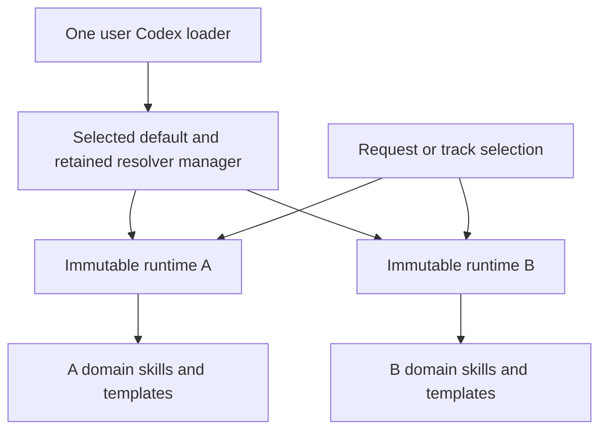
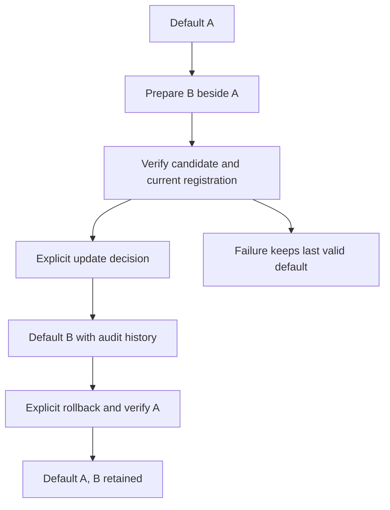
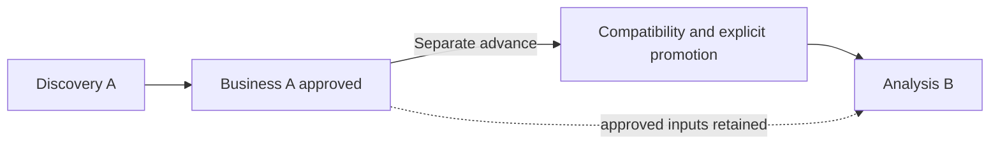
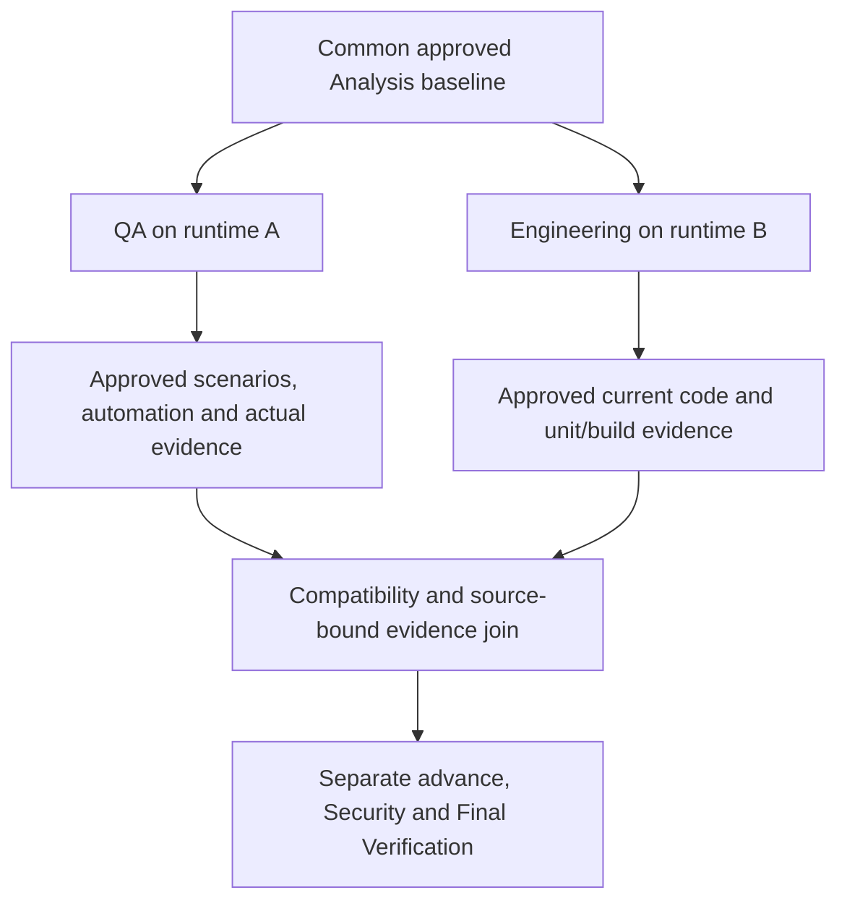
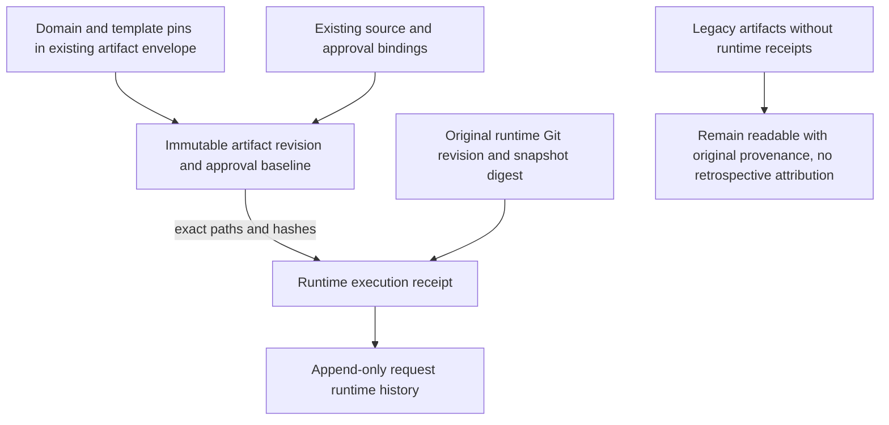

# Runtime updates, rollback and future-work promotion

[Documentation index](README.md) · [Installation commands](installation-and-adoption.md) · [Installation architecture](installation-architecture.md) · [CLI inventory](cli-reference.md)

An **installed runtime** is an immutable snapshot. The **default runtime** is selected by
one user-scoped Codex registration. An **effective request runtime** is the separately
recorded selection for future work in a request or its Engineering/QA track. An artifact's
**provenance** identifies the runtime that actually performed its recorded operation,
alongside its existing domain/template pins and source/approval bindings.

Updating or rolling back the default does not change an existing request's selection,
application code, approved artifacts, baselines, decisions, lifecycle or Git history.
Promotion requires another explicit human decision. Nothing searches for updates online.

## Locations and first installation

Use the [normal installation procedure](installation-and-adoption.md#install-an-approved-committed-revision).
The installer still refuses to replace an occupied unrelated registration, and an ordinary
`install` never means “switch my default.” Identical installs verify and replay.

```text
~/.agents/skills/sdlc/
    SKILL.md                       # one native Codex loader, not four domain registrations
    installation.json              # selected default; managed schema 0.2 adds manager/history
~/.local/share/ai-sdlc/
    venv/                          # explicitly prepared interpreter, retained separately
    runtimes/<revision12>-<digest16>/
        installation.json          # immutable payload/interpreter pin
        orchestrator/skill/
        orchestrator/domain-skills/
        orchestrator/templates/
        orchestrator/scripts/
    sessions/                      # external procedural context receipts, not credentials
```

Each runtime keeps its own shared instructions, domain catalog/packages, templates and
validators together. Do not move packages between snapshots or edit consumed pins.
The [architecture guide](installation-architecture.md) explains host discovery and
package loading. The diagram shows references, not automatic work or agent execution.



Old two-field registration metadata stays readable without a read-time migration. A
first explicit update records versioned administrative history and replaces the owned
loader. Previously installed snapshot bytes remain unchanged. The retained resolver
manager lets a rollback select an older default without losing the ability to resolve
already managed requests. It is not a remote registry, service or automatic upgrade.

## Inspect, prepare, update and roll back

Normal users can ask “Which runtime is active?”, “Update the default to this reviewed
revision,” or “Roll back the default.” The assistant handles paths, operation IDs and
expected digests internally, using your declared identity and actual decision wording.
These are natural-language intentions, not new routing enum values or lifecycle verbs.

The following are **tool-facing terminal patterns**. `PYTHON`, `SOURCE`, `APP`, `SHA`,
`DIGEST` and `OP` are placeholders, not literal values. Invoke installed Python tools
with `-B` to avoid creating bytecode inside an immutable snapshot. Read `show` before a change and
keep the same operation ID, expected digest and inputs on an uncertain retry.

```text
PYTHON -B orchestrator/scripts/install.py show --skill-root SKILLS
PYTHON -B orchestrator/scripts/install.py list --runtime-root RUNTIMES
PYTHON -B orchestrator/scripts/install.py prepare --source SOURCE --revision SHA --project APP --runtime-root RUNTIMES --python PYTHON
PYTHON -B orchestrator/scripts/install.py update --source SOURCE --revision SHA --project APP --expected-default DIGEST --operation-id OP --actor NAME --decision TEXT
PYTHON -B orchestrator/scripts/install.py rollback --expected-default DIGEST --operation-id OP --actor NAME --decision TEXT
PYTHON -B orchestrator/scripts/install.py rollback --runtime EXACT_PREVIOUS_RUNTIME_PATH --expected-default DIGEST --operation-id OP --actor NAME --decision TEXT
```

Use `--skill-root SKILLS` for an isolated non-default registration. Update reuses the
current runtime parent and interpreter unless `--runtime-root` / `--python` are supplied.
`prepare` defaults to the standard runtime root and invoking interpreter; it creates a
snapshot **without** registering or activating it. New prepare/update operations require
an exact commit ID, or an explicitly labelled `--preview-working-tree` with HEAD as base.
No fetch/pull occurs. Preview is not a committed release.

| Operation | What changes | What stays unchanged |
|---|---|---|
| `prepare` | A new external snapshot, if not already present. | Default, request records and application. |
| `update` | Verified owned registration selects the prepared runtime; append administrative before/after decision. | Prior snapshots and every application's records/code. |
| `rollback` | Default selects the previously active verified snapshot; append rollback decision. | Application, request selections, approvals, evidence and completed stages. |
| `show`, `list`, `verify` | Read-only inspection. | All managed state; no silent repair. |

Rollback without a target restores the previous selection. An exact retry replays the
original result; a second distinct rollback does not silently toggle forward. Explicit
targets must have recorded activation history and remain intact on disk. Different
version numbers alone say nothing about compatibility with a particular request.

The update diagram is administrative. Its arrows are explicitly requested operations,
not SDLC progression. A bad candidate never authorizes a partial switch.



## Existing requests and new work

Read-only adoption still checks an explicitly selected application. It creates no
request and does not approve existing code. New requests normally use the active default;
they gain `runtime-history.json` in the Epic, recording initial selection and exact
creation-file digests. Other stage artifacts still appear only when their operations run.

Updating the default does not silently change old requests. Legacy requests lacking
whole-runtime provenance remain readable. Before further managed writes, an explicit
`runtime-bind` decision selects **future** work. It does not assert which runtime produced
old artifacts. Use recorded domain/template pins and approved baselines as their original
authority; missing historical runtime attribution remains unknown.

Routine writes run from the effective snapshot with a context receipt for that exact
request/track selection. A missing, changed or unsupported runtime blocks work. A legacy
binary without `sdlc-execution/1` can be inspected, but cannot perform managed writes
through the new resolver. After rolling the default back to such a binary, managed
requests still resolve their retained capable runtime; unprotected new work is blocked.
Do not evade that boundary by invoking an old unrestricted CLI directly.

## Preview and explicitly promote a future activity

Example: Discovery and Business were produced/approved under A. Business has separately
advanced to Analysis readiness. The human asks to use B for Analysis. The assistant:

1. Verifies B's snapshot/environment and reads the request with B in a separate process.
2. Compares supported contracts, actual source interpretation and domain/template pins.
3. Presents the compatibility result, future scope and any required reconciliation.
4. Obtains explicit human confirmation, keeping the actual decision and reason.
5. Rechecks current request/source revision under the project lock and appends promotion.
6. Requires the correct fresh conversational context before B performs Analysis work.

The original Discovery/Business bytes and approvals remain unchanged; no upstream reopen
or reapproval is required solely because B has a different runtime version.



Safe boundaries include unstarted Discovery, Business/Analysis readiness, Engineering
Design/Planning/Development readiness, and eligible new QA design/automation work.
Do not switch an active artifact revision, approval or test execution in flight. Active
promotion is deferred until a supported safe boundary. An initial legacy binding in
already-started work requires an explicit reconciliation statement, without inventing
past attribution. Promotion does not itself approve an artifact, advance, assign or start.

| Assessment | Meaning / next action |
|---|---|
| `compatible` | Contract projections and actual readers agree; explicit human promotion is still required. |
| `requires_reconciliation` | New instruction/template content needs an explicit future-scope impact assessment, or activity must first reach a safe boundary. Text alone cannot override the active-stage boundary. |
| `incompatible` | Unsupported protocol/schema/storage/transition/approval/evidence/recovery contract, changed source interpretation or unreadable/corrupt inputs. Block and explain; never migrate old approvals to make the check pass. |

The assessment uses existing validators and actual candidate readers, current supported
metadata/storage/governance/work-track contracts, state transitions, source fingerprint,
approval/evidence/recovery profile, domain contracts and template contracts. Pin differences
are reviewed without treating version-number ordering as proof. This is a conservative
structural/contract assessment, not proof that two models or changed code have identical
business semantics. Runtime publishers must review and maintain compatibility declarations
and regression evidence honestly; human impact review remains necessary.

Tool-facing operations, using the selected runtime's CLI (or the verified resolver for
selection administration):

```text
sdlc.py --project APP runtime-status ID --track engineering --skill-root SKILLS
sdlc.py --project APP runtime-check ID --runtime CANDIDATE --track engineering
sdlc.py --project APP runtime-bind ID --runtime CANDIDATE --expected-runtime-revision R --operation-id OP --actor NAME --decision TEXT --reason TEXT
sdlc.py --project APP runtime-promote ID --runtime CANDIDATE --track engineering --expected-runtime-revision R --operation-id OP --actor NAME --decision TEXT --reason TEXT [--reconciliation TEXT]
```

Omit track selection on the shared path. Bind is request-wide; downstream promotions
select Engineering or QA explicitly. Tokens come from fresh inspection, not manual YAML
edits. Actor flags can be omitted for the existing local declared profile; its informational
roles are not authentication/RBAC. See the [full argument reference](cli-reference.md).

## Correct runtime before correct instructions

The loader resolves the target before treating a default workflow as the request's
workflow. The agent must load the effective snapshot's shared instructions and relevant
domain/templates, then use its interpreter and CLI. Switching the default file does not
replace instructions already in a running conversation.

A `runtime-session` receipt binds a caller-declared fresh context, project, request/track,
selection and exact shared-instruction digest. A context ID cannot be reassigned to another
runtime; the same runtime context can address separate scopes with separate receipts.
The CLI verifies those bindings, the executing snapshot and current selection **under the
existing project write lock**. A receipt from A cannot authorize a B executable or a
newly promoted selection. New-request receipts also recheck the current default.

```text
sdlc.py --project APP runtime-session ID --track engineering --skill-root SKILLS --fresh-context-id CONTEXT --instructions-digest DIGEST
sdlc.py --project APP --runtime-session RECEIPT engineering-write ID ...
```

These arguments remain internal to the assistant. If another runtime's instructions were
already loaded, require a fresh conversation/host reload; do not mint a new ID in that
same mixed context. Receipts are **procedural declarations**, not trusted inspection of
the actual host/model context. Python can reject reused declared IDs and wrong binaries,
but cannot prove the model forgot previous instructions. An unrestricted agent can lie
or bypass old tooling; local hashes and receipts are not publisher or human authentication.

## Engineering and QA can use compatible different runtimes

Selections are scoped to the Analysis cycle and track. A specific QA selection can stay
on A while Engineering adopts B; unrelated QA scenarios/approvals remain valid. A new
Analysis cycle inherits shared authority unless explicitly selected again, not an old
track cycle's approval. Upstream reopening still follows its existing lifecycle rules.



Applicable QA execution/completion, Engineering verification/Security/finalization checks
read current selected and recorded runtimes and compare their contract interpretation.
Missing/corrupt/incompatible snapshots block the join; distinct compatible pins do not.
Existing source, approval and real-evidence gates still decide readiness. Passing fixture
commands are not proof of a real browser or human acceptance.

## Artifact provenance without historical rewrites

`runtime-history.json` is an independently versioned, append-only request audit with a
linked content-digest chain. Selection records contain previous/new runtime, scope/stage,
compatibility, actual human confirmation, declared actor, reason, time and reconciliation.
Execution receipts use the original operation ID and bind that runtime's full Git revision,
installation digest/path, and exact created/changed file hashes. Immutable bundle paths
identify the baseline; existing artifact envelopes retain domain/template/source pins.
Those fields are referenced rather than duplicated into a second requirements model.



The ledger does not change old baseline formats/hashes or add a retrospective pin.
Managed receipts are journaled around the existing operation under the same project lock.
If business state commits but provenance completion fails, normal readers/writers block
instead of presenting unrecorded current authority as complete. Exact retries/recovery
finish the original operation; they never create another approval. Full retained snapshots
and receipts favor auditability over storage/performance and are not tamper-proof against
coordinated unrestricted edits.

## Failure recovery and limitations

| Diagnostic | Safe response |
|---|---|
| `E_INSTALL_CONTRACT` | Keep a capable verified resolver; two unsupported legacy snapshots cannot establish managed dispatch. |
| `E_INSTALL_CONFLICT` / `E_INSTALL_STALE` | Inspect owned registration/current digest; ordinary install never switches defaults. |
| `E_INSTALL_BUSY` / `E_PROJECT_BUSY` | Establish whether a writer remains. Never automatically remove its lock. |
| `E_INSTALL_RECOVERY` | Inspect `.sdlc-runtime-switch.json` in the skill root; `install.py recover --skill-root SKILLS` restores the recorded prior registration only when files match before/after. |
| `E_RUNTIME_BIND_REQUIRED` | Obtain explicit initial future-work binding; do not invent historical runtime attribution. |
| `E_RUNTIME_CONTEXT` / `E_RUNTIME_CONTEXT_RELOAD` / `E_RUNTIME_MISMATCH` | Resolve exact selection, load correct instructions in a fresh context and execute the correct CLI with its receipt. |
| `E_RUNTIME_INCOMPATIBLE` / `E_RUNTIME_BOUNDARY` / `E_RUNTIME_RECONCILIATION` | Review incompatibility or reach a safe boundary; supply a real impact assessment only where supported. |
| `E_RUNTIME_WRITE_UNCERTAIN` / `E_RUNTIME_RECOVERY` | Inspect saved selection/receipt and pending transaction; exact retry or explicit recovery, never a fresh operation ID to bypass uncertainty. |
| `E_RUNTIME_HISTORY` / `E_INSTALL_INTEGRITY` | Restore known-good evidence/snapshot; no automatic repair or rehashing to legitimize changed bytes. |

Registration switching uses an external lock and durable before/after intent for its two
files; incomplete switches block the supported resolver until recovery. Handled failures
restore the last valid registration. Old snapshots are never deleted. Per-request
provenance intent is transient at `requirements/.sdlc-runtime-transaction.json`, within
the already governed namespace; no source exclusions or context-checkpoint system is added.

Use `sdlc.py --project APP --runtime-session RECEIPT runtime-recover` from the original
runtime for incomplete creation with exact completed-file intent or a known interrupted
Business/Analysis publication. Recovery rolls forward only recorded original transaction
bytes. For an unknown after-state without that journal, retry the original idempotent
operation; unrelated edits or incomplete creation remain blocked for operator inspection.
When a complete after-state is recorded, provenance recovery verifies it before appending
the receipt. Hard exits can leave existing locks; inspect before removing abandoned locks.
No operation rewrites historical approved artifacts to recover.

The PoC targets cooperating local POSIX writers. It does not provide distributed locking,
enterprise authentication/RBAC, publisher signing, a process sandbox, project-specific
catalog policies, automatic networking/upgrades or Claude runtime acceptance. Resolved
absolute runtime/interpreter paths must remain available; relocation/restoration is an
explicit operator responsibility. Future work cannot silently substitute another package
merely because an old pin is missing.


## Focused acceptance rehearsal

Use two committed revisions in disposable local source repositories, an empty external
runtime/skill root, and a disposable application. Never run this rehearsal against the
real user registration or preserved demonstrator.

1. Install A; record the snapshot digest, owned registration and application hashes.
2. Prepare B. Verify that A remains the default and ordinary install does not switch it.
3. Explicitly update to B with A's expected digest and a unique operation ID. Retry the
   same intent; confirm one administrative event and unchanged application files.
4. Create a request with B using a declared fresh context. Roll the default back to A;
   inspect the request and confirm that its effective selection remains B.
5. In a second request, complete Discovery/Business under A using real human decisions.
   At Analysis readiness, inspect B's compatibility and obtain separate promotion
   confirmation. Promote, open a fresh B context, and draft Analysis without rewriting
   the approved upstream inputs. Compare their hashes and audit records.
6. Attempt a write using A or the previous context: expect rejection. Exercise compatible
   independent Engineering/QA pins in a fixture, then verify the joined input contracts.
7. Inject switch/provenance interruptions only in isolated tests. Inspect pending intent,
   recover through the supported operation, and verify exact retries and old baseline bytes.

The automated suite uses fictional decisions and independent processes; it is not a
substitute for human conversational acceptance of a fresh host context. Sessions default
to the external user data directory; `SDLC_RUNTIME_SESSION_ROOT` isolates disposable test
receipts. These receipts are declarations, not authenticated identities or proof of the
model's memory state.

Source-checkout tooling for unbound legacy requests remains available for compatibility;
it is not claimed as managed runtime-provenance execution. A bound request rejects the
wrong/source runtime. Unrestricted old binaries or manual filesystem edits remain outside
the cooperating-writer trust boundary. Deleting an entire runtime sidecar cannot be
cryptographically distinguished from a legacy request: an installed writer requires
explicit initial binding rather than silently adopting the default or inventing history.
