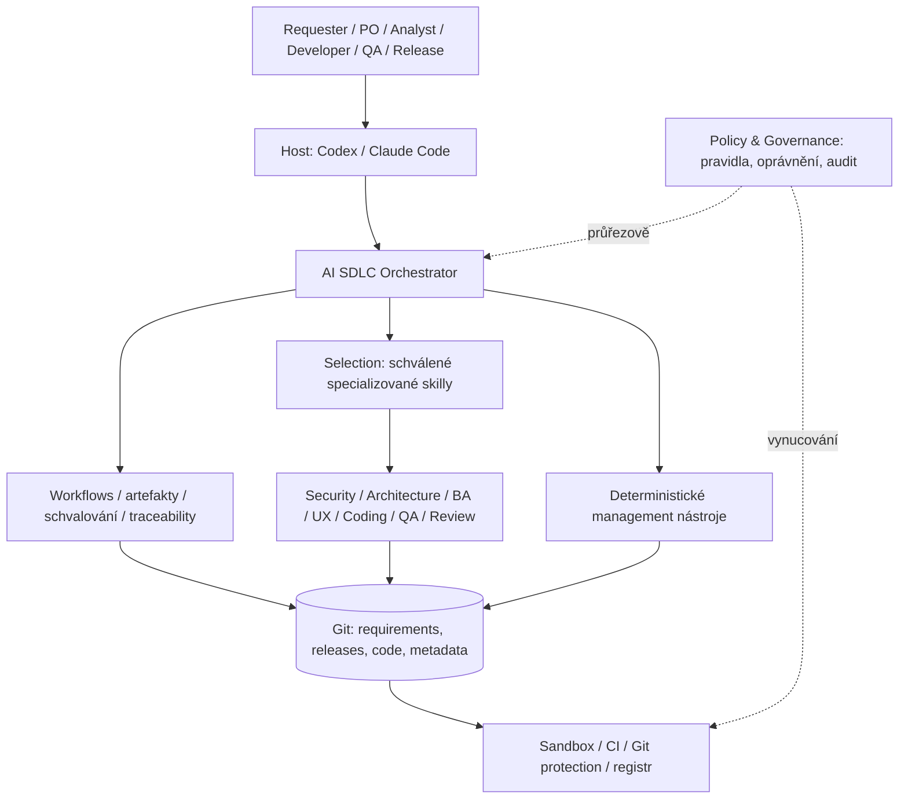
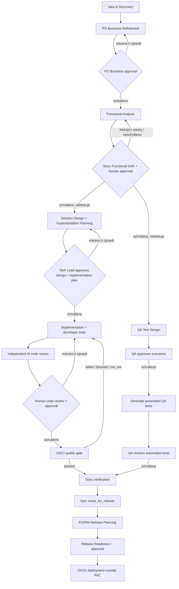
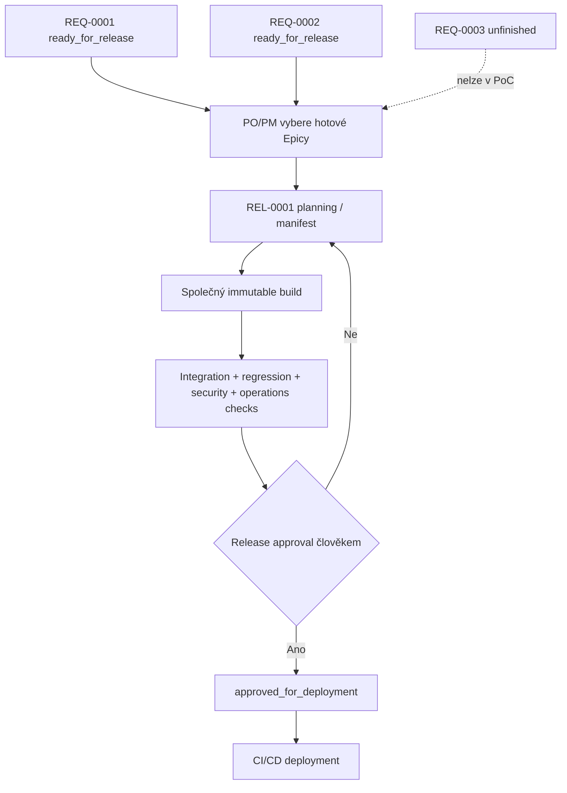
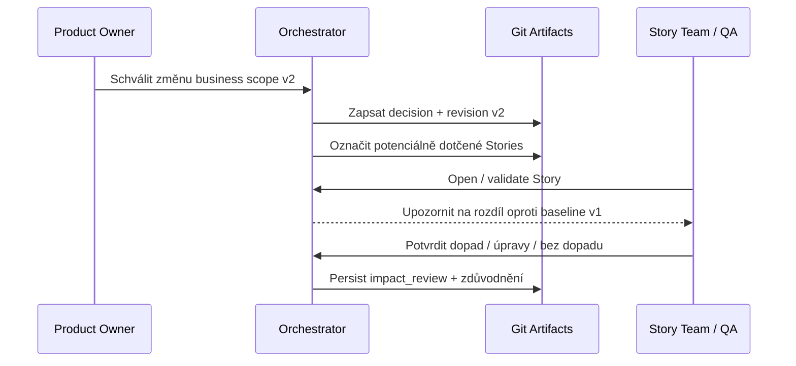

# AI SDLC Orchestration Skill — sjednocená pracovní specifikace

**Verze dokumentu:** 0.3 (konsolidace návrhových rozhodnutí)  
**Datum:** 2026-10-28  
**Stav:** návrhový dokument pro PoC a case study; nejde o implementovanou funkčnost  
**Zdroj:** původní pracovní specifikace AI SDLC (427 řádků), navazující návrhová diskuse a architektonický dodatek.  
**Čtení dokumentu:** **[D]** potvrzené rozhodnutí, **[P]** zjednodušení PoC, **[T]** cílová architektura, **[O]** otevřený detail. Při změně rozhodnutí se upřednostňuje novější explicitní dohoda.

## 1. Poslání a hranice

**[D]** Jeden vstupní AI SDLC *orchestration skill* pro podporu business requestera, Product Ownera, analytika, Tech Leada, developera, QA a release odpovědností. Řídí přechody, artefakty, schvalování, stav, vazby a auditní stopu. **Není** monolitickým balíkem odborných znalostí, novou webovou aplikací ani náhradou Jiry. Využívá schválené externí specializované skilly. Hostitelská platforma pro PoC: Codex; přenositelnost na Claude Code je požadavek, nikoli bez ověření garantovaná vlastnost.

**[D]** Git-native a local-first: soubory YAML/Markdown a zdrojové kódy jsou primární perzistentní kontext. Konverzační paměť není zdroj pravdy. V rámci širší Alza case study jde o část A (AI napříč SDLC); část B (dekompozice monolitu) je samostatná iniciativa. Modul, Story a tým jsou různé koncepty.

## 2. Základní principy

1. **[D]** Hierarchie požadavků **Epic → Story** s identifikátory `REQ-0001`, `REQ-0001/S01`; stabilní ID nezávislá na cestách. Jeden modul má 0 až N Stories a Epic může zasáhnout více modulů.
2. **[D]** Složka Story má tvar `S<NN>-<module-slug>--<change-slug>`; např. `S03-customer-account--manage-price-alerts`.
3. **[D]** Machine-readable YAML metadata; lidsky čitelné Markdown artefakty, bez duplicitních autoritativních popisů. Změny souborů, ID, vazeb a validace provádí deterministické skripty, ne improvizované příkazy LLM.
4. **[D]** Lidská schválení jsou oddělená od AI analýz; schválení musí referencovat konkrétní revizi artefaktu. Git diff říká *co*, `decisions.md` také *proč*.
5. **[D]** Epic i Stories se průběžně zpřesňují: přibývají, mění se nebo se logicky ruší; Story lze přemístit pouze v rámci stejného Epicu. ID, rodičovský Epic a historii zachovat. Dopady změn na rozpracovanou práci vyvolají `impact_review`, ne automatické přepsání kódu.
6. **[D]** Role reprezentují odpovědnosti, ne nutně různé osoby. Business Requester může být zároveň Product Owner, přesto potvrzení nápadu není business approval.
7. **[D]** Orchestrátor automaticky vybírá důvěryhodné specializované skilly podle činnosti, pokud jsou dostupné; zkušený uživatel může výběr přepsat v mezích bezpečnostní politiky.
8. **[D]** Security a governance jsou průřezové, od Discovery po Release; instrukce skillu nejsou bezpečnostní hranice. Skutečná omezení vynucují oprávnění, sandbox, Git/CI a další nástroje.
9. **[D]** Context Management rekonstruuje stav z Git artefaktů, implementačního plánu a evidence problémů. **Samostatný `checkpoint.md` ani checkpoint systém nezavádíme.**
10. **[D]** Implementace a nezávislé QA test design mohou probíhat paralelně; spojují se až při finálním ověření.
11. **[D]** Release je nezávislá entita obsahující jeden nebo více připravených Epiců; nikoli potomek Epicu. Zařazení do releasu je business rozhodnutí, ne automatický důsledek dokončení.
12. **[D]** Orchestrátor má vlastní verzování oddělené od verze datového schématu; závislosti na odborných skillech jsou verzované a připnuté k neměnné revizi.

## 3. Architektura



**[D]** Skill je sada instrukcí; tool vykonává operace; subagent je samostatný kontext. Použití specializovaného skillu samo o sobě neznamená spuštění subagenta. Review má ideálně samostatného read-only subagenta spuštěného nativně hostitelem.

## 4. Struktura projektu a datový model

```text
project/
├── requirements/
│   └── REQ-0001-price-alerts/
│       ├── metadata.yaml
│       ├── idea.md
│       ├── business.md
│       ├── decisions.md
│       ├── specification.md           # epic-wide, jen když potřeba
│       ├── assets/                     # volitelné sdílené reference
│       └── S03-customer-account--manage-price-alerts/
│           ├── metadata.yaml
│           ├── specification.md       # FR, AC, scénáře, zdroje
│           ├── design.md
│           ├── implementation-plan.md
│           ├── tests.md
│           ├── decisions.md           # pokud vzniknou lokální rozhodnutí
│           └── assets/                # lokální wireframy/screenshoty
├── releases/
│   └── REL-0001/
│       ├── metadata.yaml
│       ├── manifest.yaml
│       └── readiness.md
├── src/
└── ...
```

**[D]** `metadata.yaml` = aktuální stavy a odkazy; `decisions.md` = důvody a historie rozhodnutí; Git = verze skutečného obsahu. Nezdvojovat autoritativní text FR/AC současně v YAML a Markdownu. Použít strojově čitelné identifikátory/front matter či jinou jednoznačnou strukturu v jednom zdroji pravdy. `tasks.md` v původní specifikaci se v novější dohodě konkretizuje jako `implementation-plan.md`; při implementaci zajistit jeden autoritativní název nebo migraci/alias.

**[O]** Finální status enumy, schema schvalování, přesná serializace FR/AC/TC, kolize ID mezi nezávislými klony a strategie relativních odkazů zůstávají otevřené.

### Vzor stavů / referencí (ilustrativní, ne finální schéma)

```yaml
# Story metadata.yaml (ukázka)
schema_version: '1.0'
id: REQ-0001/S03
parent: REQ-0001
module: customer-account
status: implementation
specification_baseline: 'v1'
artifacts:
  specification: {path: specification.md, status: approved}
  design: {path: design.md, status: approved}
  implementation_plan: {path: implementation-plan.md, status: approved}
  tests: {path: tests.md, status: in_progress}
dependencies: {depends_on: [], related_to: []}
impact_review: {status: not_required}
```

## 5. Management a lifecycle příkazy

**[D]** Konceptuální rozhraní (skutečná syntaxe v Codex/Claude Code vyžaduje ověření):

- `new`, `open`, `list`, `update`, `add-story`, `rename`, `move-story`, `link`, `unlink`, `cancel`, `reopen`, `validate`.
- Workflow: `refine`, `analyze`, `design`, `implement`, `review`, `release plan` a kontroly readiness.
- Skill lifecycle: `version`, `check-update`, `upgrade`, `changelog`, `doctor`.

**[D]** `move-story` mění umístění Story pouze uvnitř stejného Epicu; zachovává její ID a `parent`. Přesun do jiného Epicu musí odmítnout bez změny souborů. Převod Stories mezi Epicy není součástí tohoto rozhraní.

**[P]** Migrace schématu, robustní paralelní číslování požadavků, push notifikace a integrace s Jira/Azure DevOps jsou mimo PoC. Kontrola verzí musí při nekompatibilitě bezpečně skončit. Notifikace o změnách v PoC fungují při `open` / `list --pending-impact`, nikoli jako automaticky doručené zprávy týmům.

## 6. Role a přechody SDLC



**[D]** Nejde o waterfall: různé Stories postupují paralelně; QA a engineering větve mohou postupovat paralelně. Stav Epicu a jednotlivých artefaktů jsou různé dimenze.

### 6.1 Idea & Discovery — Requester

**[D]** `$sdlc new` ihned vytvoří *lokální* pracovní Epic (`metadata.yaml`, `idea.md`). Přirozená konverzace pokrývá problém, cílové uživatele, hodnotu, cíle, počáteční scope, success criteria, předpoklady, otevřené otázky a hypotézy dotčených oblastí. Žádný závazný design ani automatická dekompozice na Stories.

**[D]** Během discovery se průběžně ukládá na disk, ale **bez automatického `git add`, `commit`, `push`**. Po potvrzení správnosti obsahu nastaví `ready_for_refinement` (nikoli approval). Staging/commit vyžaduje samostatný výslovný souhlas; push je zvlášť. Před zveřejněním zkontrolovat kolizi ID. `$sdlc open` umožňuje návrat k lokální práci, pokud soubory existují.

### 6.2 Business Refinement — Product Owner

**[D]** `business.md`: business value, priority, cílová skupina, initial/out-of-scope, úspěch/metriky, omezení, závislosti a otevřené body. PO může založit první navržené Stories; další mohou vzniknout během analýzy, designu i implementace. Navržená Story není automaticky připravená k implementaci. Překryv Requester/PO neznamená přeskočení produktového rozhodnutí.

**[D]** Před přechodem do Functional Analysis musí Product Owner schválit konkrétní revizi `business.md`; schválení zaznamenává identitu, čas a revizi. Potvrzení nápadu Requesterem toto business approval nenahrazuje.

### 6.3 Business / Functional Analysis

**[D]** Analytik otevře Story, načte Epic a dostupné reference, popíše scénáře, alternativy, vstupy/výstupy, validace a business pravidla. Výstupem je `specification.md` s funkčními požadavky `FR-...`, akceptačními kritérii `AC-...`, otevřenými body, závislostmi a provenance (business zadání / prototyp / návrh AI / potvrzeno člověkem). AI nepovažuje pozorované chování prototypu automaticky za schválený požadavek.

**[D] Reference Artifacts** jsou volitelnou strukturovanou součástí analýzy a mohou vzniknout už v Discovery: wireframe, Figma URL, user-flow, screenshot, interaktivní UI nebo funkční PoC z Git repo, ZIP, HTML, běžícího dema. Evidence zahrnuje typ, URL/cestu, verzi/commit či checksum, stav `exploratory`/`approved`, vazbu na Epic/Story a datum schválení. Prototyp je ukázka zamýšleného chování, ne závazná produkční architektura. Cizí kód automaticky nespouštět; statická analýza a případné bezpečné izolované spuštění jsou oddělené činnosti. Očekávané chování musí být zapsáno textově; screenshot sám o sobě nenahrazuje funkční požadavek.

**[D]** Traceability: `Reference Artifact → Scenario → FR → AC → TC → Automated test → Execution result`, vazby na Stories, implementační úkoly a změny. Identifikátory jsou stabilní; jeden zdroj pravdy.

**[D] Flexible Definition of Ready (DoR)** pro Story: business kontext, jasné chování, ověřitelná AC (včetně důležitých chyb), relevantní UI/UX podklady, závislosti a otevřené otázky. Výsledek `not_ready`, `ready_with_warnings`, `ready_for_solution_design`. Neexistují-li blokující otázky, je možné pokračovat i s neblokujícími; každá má vlastníka a deadline/fázi vyřešení. AI hodnotí úplnost, člověk potvrzuje obsah. Oddělit Ready for Design od Ready for Implementation.

### 6.4 Solution Design a Implementation Planning

**[D]** AI musí před návrhem analyzovat dostupnou codebase a dokumentaci; nedostupný kontext označí. `design.md` pokrývá současnou architekturu, alternativy, odůvodnění, navrhované změny API/dat/integrací, Mermaid diagramy, bezpečnost a další NFR, rizika a závislosti. Významná rozhodnutí mohou mít ADR. High-level a detailní design jsou úrovně detailu podle Story; nejsou povinně samostatnými stavovými fázemi.

**[D]** Z designu odvodit `implementation-plan.md`: malé logické tasky s ID, popisem, závislostmi, FR/AC vazbami, cílovým výsledkem a ověřením. Stav tasku `pending → in_progress → implemented → verified → completed`; blokovaný/rušený stav řešit zvlášť. Plán je **řízeně dynamický**: drobné změny v rámci schváleného designu možné, zásadní změna potřebuje posouzení dopadů a znovuschválení.

**[D]** **Tech Lead/Senior Developer povinně reviduje a schvaluje konkrétní revizi `design.md` i `implementation-plan.md` před zahájením implementace.** Posuzuje pokrytí FR/AC, bezpečnost, rizika, závislosti a velikost úkolů. Approval ukládat s identitou, časem a verzí. Coding agent nesmí měnit schválenou architekturu bez eskalace.

### 6.5 Implementation a reprodukovatelné prostředí

**[D]** Coding agent z hostitelského počítače (Codex/Claude Code) postupuje po taskách, aktualizuje průběh a eviduje související změny, skutečně provedené testy, nálezy a Git revize. Během implementace píše relevantní unit/component testy. Dokončený kód ≠ ověřený úkol. Při návratu načte artefakty/Git a ověří reálný stav; žádný oddělený checkpoint.

**[D]** Reprodukovatelné prostředí je definováno na úrovni projektu/modulu a verzováno v Gitu. **PoC:** agent běží na hostiteli, aplikace a testy v Docker/Compose. Upřednostnit fixované image digesty a lockfiles, testovací data, migrace, izolaci sítě/volume, jasné spouštěcí a cleanup příkazy. Toto zvyšuje reprodukovatelnost prostředí, ne zaručenou identitu rozhodnutí LLM. Pokud chybí konfigurace, vzniká návrh na její vytvoření a schválení Tech Leadem; zásadní změny sdíleného prostředí vyžadují approval.

### 6.6 Code Review a Quality Gates

**[D]** Průběžné kontroly: build, lint/typecheck, static/security analysis, unit/component/integration testy, vazba na FR/AC. Reportované stavy: `passed`, `failed`, `blocked`, `not_run`. Nevykonaný test nikdy nevydávat za úspěch. Review provádět po logických změnách, ne až na konci celé Story.

**[D]** AI review preferuje *nezávislého, read-only subagenta s odděleným kontextem* a vstupy: schválená specifikace, design, plán, projektové standardy, Git diff vůči baseline, test evidence. Výsledkem jsou závažnosti a odkazy na nálezy u konkrétní revize. Self-review nesmí být vydáváno za nezávislé review. Codex PoC využije nativní delegaci, pokud v konkrétním prostředí funguje; bez vlastního adapter frameworku. Přenositelnost do Claude Code ověřit zvlášť.

**[D]** Po AI review následuje human code review a Git/CI quality gate; merge chráněné větve vyžaduje explicitní schválení člověkem a relevantní povinné kontroly. Coding agent může commitovat změny schválené implementační práce a připravovat PR v mezích oprávnění; konkrétní pravidla push/merge/deploy vynucuje hostitelská infrastruktura. Nový commit může invalidovat staré výsledky kontrol.

### 6.7 Test Management — dvě paralelní větve

**[D]** Test Design vzniká z požadavků/AC paralelně se Solution Design a implementací; **schválení testovacích scénářů není předpokladem schválení Implementation Planu.** QA role je explicitní odpovědnost (může být stejný člověk jako jiné role v malém týmu).

- **Engineering větev:** design → plán → Tech Lead approval → coding agent + developer unit/component testy.
- **QA větev:** AI navrhne `TC-...` (pozitivní, negativní, boundary, riziko, regrese); **QA reviduje a schvaluje scénáře** → AI/agent generuje automatizované testy dle projektového stacku → **QA reviduje i automatizované testy** (správnost assertions, izolace, robustnost).
- **Spojení:** po připravenosti obou větví proběhne finální Story verification, integrační/E2E/regresní ověření podle rizika. Při změně FR/AC orchestrátor vyznačí dopady pro obě větve.

**[D]** `tests.md` = testovací scénáře, vazby FR/AC, úroveň a stav automatizace, cesta k testu; výsledky běhů patří do reportů/CI evidence, ne jako opakované přepisy `tests.md`. Testovací úrovně: unit, component, integration (komponenty/databáze/broker; nemusí znamenat celou aplikaci), E2E (uživatelský proces napříč stackem). Testy se spouštějí průběžně; Docker/Compose/Testcontainers nebo adekvátní projektová infrastruktura, pro PoC prioritně reprodukovatelné kontejnery.

**[D]** Dvě samostatné brány: **Implementation Readiness** a **Test Readiness**; obě nutné pro finální Story verification. Code coverage samotné není proxy pro business coverage.

### 6.8 Epic Readiness, Release Planning, Release Readiness

**[D]** Epic dosáhne `ready_for_release`, když všechny **aktivní** Stories mají potřebné dokončení/testy/reviews/approval; zrušené Stories musí mít schválený důvod a odložené musí být vypořádány v rozsahu. To **nespouští automatické vydání**.

**[D]** PO/Product Manager vybírá hotové Epic kandidáty s ohledem na business termín a kampaně. **[P]** Prozatím lze do plánovaného Releasu přidat pouze Epicy `ready_for_release`. Žádné nedokončené Epicy, částečné Epicy nebo složité edge cases v PoC. Epic může být připravený a čekat mimo release. Nasazení a aktivace funkcionality (feature flags) jsou odlišné koncepty.

**[D]** Release je samostatná entita `REL-...` ve složce `releases/` vedle `requirements/`, může referencovat **1 až N Epiců** (datový model neomezovat na 1:1; do budoucna M:N vztah). `manifest.yaml` nese ID Epiců, schválené revize, sestavu/binární image digest a cílové prostředí. Dokumentaci a kód neduplikovat; deployable artefakty zůstávají v registry/CI systému.

```yaml
# releases/REL-0001/manifest.yaml — ilustrace
id: REL-0001
status: planning
epics:
  - {id: REQ-0001, approved_revision: abc123}
  - {id: REQ-0002, approved_revision: def456}
build:
  source_revision: null  # doplnit po společném buildu
  artifacts: []          # image digests, pokud existují
release_target: production
```

**[D]** Před schválením: kontrola závislostí mezi Epicy a proti již nasazeným funkcím; společný build a regresní/integration/E2E testy skutečné release sestavy; bezpečnost, provozní readiness, migrace, monitoring a rollback. Výsledkem `ready`, `ready_with_exceptions` nebo `not_ready`; po schválení fixovat obsah, jakákoli věcná změna vyvolá rebuild/revalidation.

**[P]** Orchestrátor končí u `approved_for_deployment` a případně čte výsledek CI/CD. Nasazení do produkce provádí existující deployment infrastruktura s lidským schválením. Release plánování není automatické po dokončení Epicu.



## 7. Specializované skilly a federovaná governance

**[D]** Orchestrační skill není vlastníkem architektonických, bezpečnostních či testovacích pravidel; používá **schválené specializované skilly** podle kompetence, např. discovery/business writing, requirements, UX/wireframing, software architecture, coding conventions, unit testing, integration/E2E testing, quality/security review. Tyto názvy jsou kategorie, **nikoli tvrzení, že odpovídající skilly již existují**.

**[D]** Automatický výběr s override. Discovery z dostupných schválených skillů, žádná automatická instalace náhodného skillu z internetu. Fallback je možný jen v mezích policy; chybí-li povinná bezpečnostní kompetence, nesmí se kontrola tiše přeskočit. Orchestrátor ověřuje kontrakty vstupů/výstupů a zaznamenává použitý skill/verzi a relevantní výsledek.

**[D]** **Federated Skill Ownership + Central Governance:** Security vlastní security skilly, Architecture architektonické, QA testovací a Engineering Excellence coding practice skilly. Každý skill má jasného vlastníka, přispěvatele, review/approval cyklus a kontrolovanou distribuci. AI Platform / Engineering Enablement vlastní orchestrátor a integraci; governance pravidla schvalování, strategie, budgetu, modelů a bezpečnosti.

**[D]** Verze orchestrátoru má manifest připnutých odborných skillů z firemního Gitu, ideálně **commit SHA**, nikoli jen pohyblivý tag. Nová verze odborného skillu nezmění bez posouzení již vydaného orchestrátora: provede se compatibility review, regresní kontroly, změna lock manifestu a nové vydání orchestrátoru. Kritické bezpečnostní změny mohou být vynuceny centrální policy ještě před dalším vydáním.

```yaml
# skills.lock.yaml — příklad, nikoli hotový resolver
orchestrator_version: 0.3.0
dependencies:
  security:
    repository: https://git.company.example/skills/security
    version: 2.3.0
    commit: 0123456789abcdef0123456789abcdef01234567
    required: true
  coding_standards:
    repository: https://git.company.example/skills/coding-standards
    version: 1.1.0
    commit: fedcba9876543210fedcba9876543210fedcba98
    required: true
```

**[T]** Interní katalog schválených skillů, ověření původu/signatur, kompatibility API/kontraktů, dodavatelský řetězec, capability registry, distribuce a automatické kontroly zastaralých verzí. **[P]** Pro demonstraci stačí 1–2 ukázkové skilly a vzor lockfile; neimplementovat firemní katalog ani rozsáhlé doménové skilly.

## 8. Security & Governance — průřezově

**[D]** Security skill může definovat zacházení s hesly/secrets, logování PII, autentizaci/autorizaci, threat modeling a bezpečnostní kontroly. V jednotlivých fázích se uplatní přiměřeně: Discovery klasifikace dat; Functional Analysis security požadavky; Design threat model; Implementation secure coding, dependency/security scanning; Testing ověření; Release final security gate.

**[D]** **Least privilege**: reviewer read-only; coding agent jen pracovní workspace/schválené nástroje; neznámé prototypy nespouštět bez izolace; internet/instalace nástrojů/secrets/push/merge/deploy pod platformními politikami a případnými approvals. Kritická omezení nemohou být vynucována pouze instrukcemi v Markdownu. Audit: kdo, kdy, co schválil, jaká revize a verze skillu, známé výjimky a výsledky ověření.

**[O]** Detailní permission matrix pro jednotlivé příkazy, identity/authn/authz, kritéria bezpečnostních výjimek, retenční pravidla a případné náklady na AI tooling dopracovat před produkčním rolloutem.

## 9. Context Management a impact review

**[D]** Tři úrovně kontextu: Project (stack, konvence, bezpečnost, architektura); Epic (záměr, změny, baseline); Story (FR/AC, design, implementace, testy, dependencies). Pro subagenta předat *minimální kontextový balíček*: stabilní ID, relevantní schválené revize, odkazy, task, pravidla, požadovaný výstup, bezpečnostní omezení. Nezaměňovat souhrny za autoritativní data.

**[D]** Žádný samostatný checkpoint. Task status, rozhodnutí, otevřené problémy, code diff, commity a test evidence jsou perzistentní; nový agent je po restartu ověří. Pokud během rozpracovaného tasku vznikne problém, zapsat jej do existující evidence plánu nebo `decisions.md`, ne zavádět duplicitní soubor.

**[D]** Schválení je navázané na konkrétní baseline. Významná změna FR/AC, designu nebo závislostí označí relevantní Stories a obě engineering/QA větve k `impact_review`; automaticky nepřepisovat již schválené artefakty. Pouze pull-notifikace v PoC (při otevření/validaci).



## 10. PoC vs cílová architektura

**[D] Potvrzený demonstrační scénář:** podle ADR-0001 rozšířit existující minimální JavaScript/Node.js To-Do aplikaci s daty v paměti o **Task Due Date Management**. Následná změna požadavku z data na datum a čas předvede impact review specifikace, designu, implementačního plánu a testů. Demo aplikace patří do `examples/todo-app/`; `orchestrator/` zůstává obecný a nezávislý na její doméně a stacku.

| Oblast | PoC | Budoucí produkční rozvoj |
|---|---|---|
| Git-native Epic/Story management a rozhodnutí | Ano, demonstrační workflow | Multi-team konflikt/ID/permissions |
| Business Discovery, Refinement, Analysis | Jeden end-to-end příklad | Škálování napříč doménami |
| Figma/artefakty/functional prototype | Reference, kontextová analýza podle dostupných nástrojů | Hloubkové vizuální / interaktivní zkoumání |
| FR/AC/traceability/DoR | Základní ID a schválení | Formalizované schéma a impact engine |
| Solution Design + Implementation Plan | Jeden reprezentativní průchod | Multi-module orchestrace |
| Docker environment | Reprodukovatelné lokální testy | Cloud ephemeral environment, policy enforcement |
| AI independent review | Nativní subagent, pokud dostupný; jinak blokovat tvrzení o nezávislosti | CI-based reviewer + platform adapters pokud nutné |
| QA větev | Schválené scénáře, kontrola generovaných testů | Plné test management / evidence systémy |
| Release Planning / Readiness | Jen celé dokončené Epicy; 1+ Epiců na release | Planned incomplete / partial Epic, pokročilý rollout |
| Federované skilly / verzované dependency | Ukázkové 1–2 skilly + lockfile | Interní katalog, bezpečná distribuce, provenance |
| Security & Governance | Průřezová pravidla a ukázkové kontroly | Centralized enterprise enforcement |
| Ticketing, push notifikace, schéma migrace | Ne | Jira/Azure DevOps, Slack/Teams, migrace |
| Deployment | `approved_for_deployment`, ne provozní deployment | Integrace s reálnou CI/CD / observability |

## 11. Otevřená rozhodnutí před implementací

1. Finální formální YAML/Markdown schéma: status enums, approval object, stabilní ID FR/AC/TC/tasks, validace a migrations policy.
2. Konkrétní repozitářová struktura skillu, bezpečné deterministické management skripty a interoperabilní invocation syntax.
3. Výběr zdrojové To-Do aplikace a její výchozí revize, počty Stories, minimální testovací rozsah a Definition of Done pro potvrzený scénář Task Due Date Management (datum → datum a čas).
4. Přesný mechanismus nativního subagenta Codex a jeho izolace/read-only; přenositelnost Claude Code experimentálně ověřit.
5. Referenční vazby na externí artifact versions a immutable build identita v reálné CI/CD.
6. Povinné vs volitelné specializované skilly v demo katalogu; co při absenci skillu a při konfliktech pravidel.
7. Permission matrix / governance rules pro reálné operace a kritické security aktualizace.
8. Rozhodnutí o kandidátech Release je nyní úmyslně omezeno na dokončené Epicy; nepovažovat za univerzální business pravidlo.

## 12. Argumentace pro case study

- AI není jen rychlejší psaní kódu: koordinuje průchod od business potřeby po ověření, podporuje T-shaped engineering a end-to-end odpovědnost.
- Lidé udržují významná business/architektura/QA/release schválení; AI zvyšuje rychlost a dohledatelnost, neodstraňuje odpovědnost.
- Federovaná tvorba odborných skillů škáluje firemní zkušenosti, centrální governance zajišťuje konzistenci, verze a budget/security compliance.
- Git-native skill je demonstrovatelná část širší enterprise AI SDLC vize, nikoli už hotová enterprise platforma.

---

**Údržba:** každé nové odsouhlasené rozhodnutí zanést do relevantní sekce i diagramu; rozlišovat závazná rozhodnutí od PoC zjednodušení a otevřených bodů. Nevydávat ilustrativní YAML ani imaginární tool API za implementovaný produkt.
