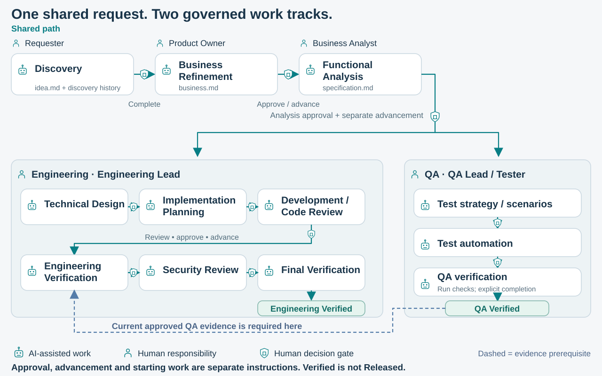

# Workflow diagram: source and visual verification

[Documentation index](README.md) · [Workflow and human gates](workflow.md)

[](assets/workflow-detailed.svg)

[Open the expanded workflow with artifact filenames and separate decision shields](assets/workflow-detailed.svg).

## Design and maintenance

The visual vocabulary derives from the approved `complete-workflow-v2-r1` Master
Overview: neutral background, navy text, white rounded cards, teal progression,
robot/person icons and small shield checkpoints. The reference SVG's SHA-256 is
`d207b0f0fbd568660d801130f2be59959fb6760a90cfde52136ec32f95dd9c00`.
The reference animation and its other assets are read-only and are not runtime inputs.

[generate_workflow.py](assets/generate_workflow.py) owns stage data, geometry and reusable
SVG definitions for both views. It needs only Python's standard library. The presentation
preparation scripts copy a prebuilt master SVG and bring animation/evidence dependencies;
this documentation generator instead reproduces the relevant visual primitives locally.
No external fonts, scripts, raster images or animation toolchain are needed by the SVGs.

```bash
python3 docs/assets/generate_workflow.py
python3 docs/assets/generate_workflow.py --check
```

Do not hand-edit generated coordinates. Change the declarative data/layout, regenerate
both files, and run the browser check. The generator reads source constants without
executing the orchestrator and checks forward Engineering/QA order and canonical names.

## Runtime alignment

The diagram describes activities and human checkpoints, not every persisted readiness
state. [Engineering contracts](../orchestrator/scripts/engineering_contract.py),
[Engineering gates](../orchestrator/scripts/engineering.py),
[independent QA policy](../orchestrator/scripts/qa_track.py) and
[work-track ownership](../orchestrator/scripts/work_tracks.py) remain authoritative.

- Shared: Discovery → Business Refinement → Functional Analysis. Discovery is explicitly
  completed; it has no invented artifact-approval operation.
- Engineering: Technical Design → Implementation Planning → Development / Code Review →
  Engineering Verification → Security Review → Final Verification → Engineering Verified.
  Engineering Verification is explicit here; the reference animation represents its
  waiting/prerequisite activity at the gate after Code Review.
- QA: Test Strategy / Scenarios → Test Automation → QA Verification → QA Verified.
  Strategy/scenarios derive from Analysis independently of Design. Automation binds
  approved Design interfaces; execution and completion bind the current approved
  implementation and automation. These source bindings are disclosed in the expanded
  view without adding more cross-lane connectors.
- The short dashed blue connection carries **current approved QA results and explicit
  completion** to the Engineering Verification exit gate. It is an evidence prerequisite,
  not a backward transition, merge or automatic authorization to advance.
- Final Verification requires current approved Engineering outputs, current QA evidence
  and current Security review without open findings. Explicit finalization produces
  `verification-report.md`; there is no extra report-approval operation.
- Current track roles are **Engineering Lead** and **QA Lead / Tester**. Presentation
  job descriptions are not substituted for serialized ownership responsibilities.

Each detailed shield is a separate human action. Paired shields mean approval of the
exact revision **then a separately authorized advancement**. Single shields mark
Discovery completion, Verification/Security advancement or explicit finalization/completion.
Security Review has no fabricated approval command. Starting work/checks remains separate
from readiness; assignment neither approves content nor starts work. Track independence
does not imply automatic parallel agents. **Verified does not mean Released.**

## Deliberate overview simplifications

The 1700×864 compact SVG uses short labels such as Planning, Develop & review, Verify
and Test design. Full stage names are retained in accessible titles and in the expanded
2740×1280 SVG. The compact view summarizes the same actions as 12 human checkpoints;
the expanded view draws all 19 individual decision shields. No gate is removed from the
underlying workflow. Expanded artifact labels include all 11 canonical Markdown filenames;
raw check results and QA completion are evidence, not invented document types.

The compact view shows the three shared filenames and omits other filenames to avoid
unreadable small text at README width. Click through for the complete artifact map.
Readiness/start substeps, exceptional remediation loops and future integrations stay in
the focused workflow documentation rather than cluttering the overview. Neither SVG
adds a stage, specialist package or workflow operation.

## Before and after

| Previous README diagram | Generated replacement |
| --- | --- |
| Engineering wrapped across rows; QA stacked vertically | Both tracks progress horizontally in parallel lanes |
| Long return-shaped dashed evidence route | Short prerequisite with one small exit bend, ending at the Verification gate |
| Lines/arrowheads beneath decorative shields | Separate connector segments stop/resume outside shield boundaries |
| Artifact/role labels crowded into cards and containers | Responsibility above stages/lanes; artifacts below stages in the expanded view |
| One image carried every annotation | Compact README overview opens an expanded artifact/decision view |

Prior SVG bytes remain in Git history; no approved presentation or SDLC evidence is replaced.

## Browser verification

[verify_workflow.py](assets/verify_workflow.py) uses a local Chrome/Chromium installation
for real rendering, measured text bounds and image previews. It does not install anything
or use a user's normal browser profile. Supply `--chrome /path/to/browser` where needed.

```bash
python3 docs/assets/verify_workflow.py
# Optional before/after comparison from an immutable earlier Git commit:
python3 docs/assets/verify_workflow.py --before 7f8dc9f12ddeca4ca2ae7b9ca6dc419d19af8948
```

Default outputs are ignored `.tmp/workflow-preview/`: native-size PNGs, 900px and 768px
README previews, text/connector audit results and an optional side-by-side comparison.
They are review outputs, not duplicate authoritative diagram sources.

The 2026-11-01 check rendered both views in Chrome and inspected their previews beside
the approved Master Overview. The geometric audit found **zero** overlapping text pairs,
labels crossing card bounds, text outside the canvas, or connectors crossing labels.
Both views have 14 cards; compact and expanded views have 12 and 19 checkpoints/shields.
Generator checks also reject connectors crossing cards/gates, nonorthogonal routes and
backward horizontal lifecycle segments. Arrowheads occur only after shields and at
stage boundaries; the evidence arrow stops at the gate's exterior.

The README fragment was rendered with GitHub's Markdown API; its returned linked
`img` markup then loaded the candidate SVG successfully at 900px in Chrome, preserving
the alt text and expanded-view target. This tests the candidate image embed rather
than claiming an interactive audit of every GitHub theme/browser. The source remains
a self-contained GitHub-compatible vector. At narrow widths, full artifact filenames
require opening/zooming the expanded SVG; a mobile viewport cannot display the whole
artifact map at reading size. Visual QA is a documentation check, not SDLC application
acceptance or proof that governance cannot be bypassed.
