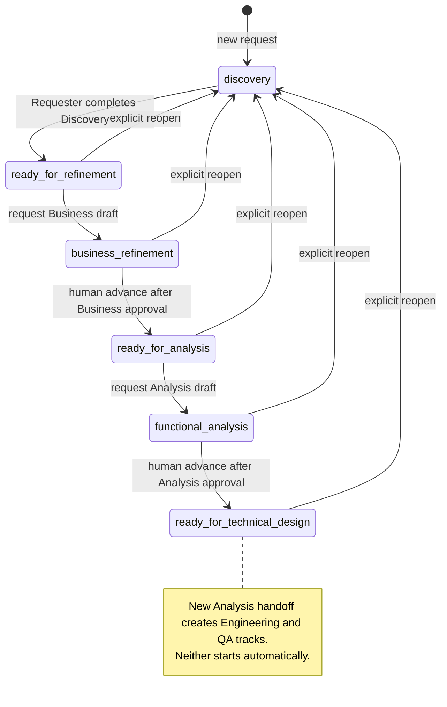
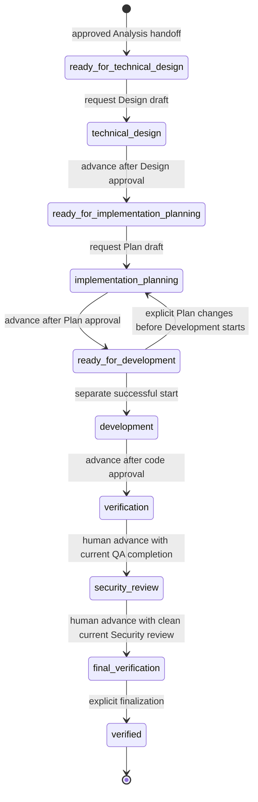
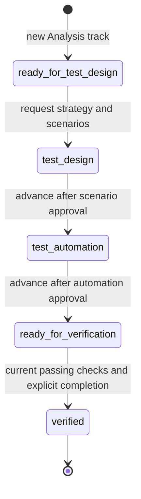
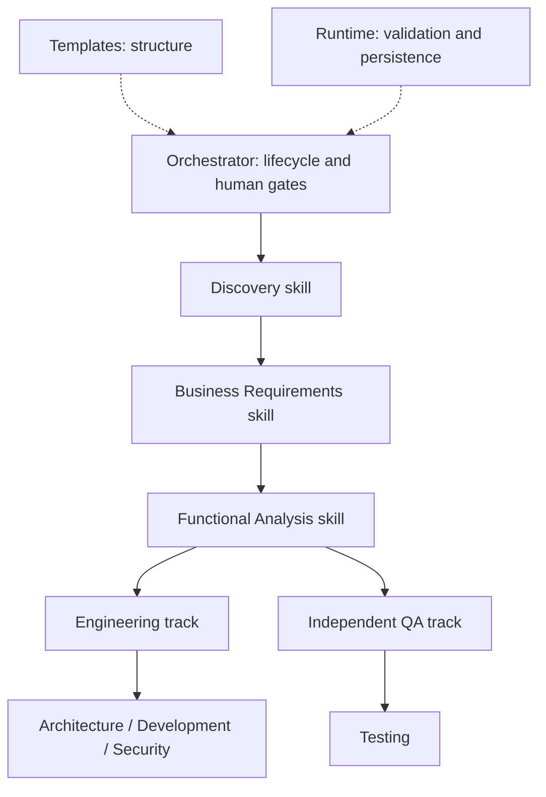

# The implemented workflow

[Documentation index](README.md)

[Project overview](../README.md) · [Getting started](getting-started.md) · [Detailed work-track contract](work-tracks.md)

A request moves from business intent to a verified change through three shared stages,
then independently governed Engineering and QA tracks. This page describes the current
PoC. The [working specification](specification.md) also contains historical planning and
future Story/Release architecture; those are not additional executable stages.

## Who does what?

A **skill** is guidance read by the coding agent. The agent interprets meaning, asks
questions, drafts documents and uses host tools to implement/test. Deterministic Python
operations validate structure and revisions and persist state, history and approvals.
A human supplies intent, reviews the results and makes consequential decisions.

The [installation architecture](installation-architecture.md#how-specialist-guidance-is-selected-and-used)
explains where these instructions live and when the agent reads them. Domain packages
are bundled file resources, not seven additional native registrations or automatically
running specialist agents. Templates define document structure; Python checks and
records the resulting artifacts, rather than executing the Markdown as a program.

A role is an accountable responsibility, not necessarily another person. The PoC uses
locally declared identities; it does not authenticate people or enforce role-based
access. Different roles and QA's independent input authority do not establish an
independent human reviewer. Source author self-review is not independent review.

## Shared path

| Stage | Responsible role | Output / next decision |
|---|---|---|
| Discovery | Requester | Original `idea.md` plus append-only `discovery.yaml`. Review confirmed intent, assumptions and unresolved questions, then explicitly complete Discovery. |
| Business Refinement | Product Owner | Review/revise `business.md`. Explicit approval freezes the revision; separate advancement enables Functional Analysis. |
| Functional Analysis | Business Analyst | Review/revise `specification.md` with functional requirements and acceptance criteria. Approve the exact revision, then separately advance to create both work tracks. |

The assistant should offer a useful review rather than ask every conceivable question.
You can request a review at any time or stop questioning. Stopping questions is not
completion, and completion is not Business approval. Unknown/deferred issues remain
visible and must not be filled with invented decisions.

New requests start in `discovery`. Explicit completion enters `ready_for_refinement`;
Business advancement enters `ready_for_analysis`. Next documents are prepared only on
request, from the applicable approved upstream baseline.

## Engineering track

The current required role is **Engineering Lead**. The presentation may describe the
person doing the work as a software engineer; that is not another serialized role.

| Activity | Main output | Gate / next action |
|---|---|---|
| Technical Design | `technical-design.md`, using Architecture and Security guidance. | Human review, explicit Design approval, separate advancement to Planning readiness. |
| Implementation Planning | `implementation-plan.md`: tasks, approved paths, requirement links and unit/build checks. | Human Plan approval, separate advancement to Development readiness. |
| Development / Code Review | Application code, unit/build results, `code-review.md`. | Explicit successful Development start before edits; human review and source-bound code approval, then separate advancement to Verification. |
| Engineering Verification | Current implementation approval plus current QA execution/completion evidence. | The joined evidence gate must pass before a separate advancement to Security Review. |
| Security Review | `security-review.md`: findings, remediation and scoped review evidence. | Findings require the supported remediation flow. Human review and separate advancement, not an invented Security approval operation. |
| Final Verification | `verification-report.md`: results and disclosed scope/uncertainty. | Explicit finalization marks Engineering `verified`; it does not release or deploy. |

Readiness is not work initiation. Design/Plan approvals do not authorize coding. A failed
or pending Development start cannot authorize edits. Source changes can make a Plan or
code approval stale even if the document itself did not change. Before Development has
started, explicit Plan feedback can use [safe replanning](engineering.md#pre-development-plan-recovery).

## QA track

The required role is **QA Lead / Tester**. QA strategy and scenarios derive from the
approved Functional Analysis; they do not wait for Design or copy its expected behavior.

| Activity | Main output | Gate / next action |
|---|---|---|
| Test design | `test-strategy.md` and `test-scenarios.md`, with source-backed cases. | One human scenario approval binds both documents; separate advancement enables automation. |
| Test automation | QA code under `qa/` and `test-automation.md`. Approved Design interfaces can support concrete automation. | Separate human automation review/approval; separate advancement to Verification readiness. |
| QA Verification | Actual approved integration/UI checks and their source-bound evidence. | Explicitly start checks and approve any required dependency setup. Inspect results, then explicitly complete QA to mark it `verified`. |

Preparing tests does not execute them. A category label such as “UI” is not proof of
browser interaction. Failed, blocked or unexecuted checks cannot be reported as passed.

## Where the tracks meet

The evidence connection is a **prerequisite**, not a reverse lifecycle transition or a
new merged ownership state. Engineering needs current approved code; QA needs approved
strategy/scenarios, reviewed automation and actual current results. QA must explicitly
complete verification; Engineering then requires its own advancement decision.

Changing application or QA code can stale execution results. Unrelated scenario authority
can remain valid, but the joined gate cannot use old results for changed inputs. Security
and finalization recheck the joined evidence. The final report discloses verified scope,
blocked/excluded requirements, unresolved questions and authorized prototype limitations.

QA can finish before Engineering; it does not trigger Engineering work automatically.
The tracks are not Git branches or a scheduler for concurrent agents.

## Decisions, ownership and revisions

- **Review:** read and assess; no approval or transition.
- **Approval:** a human accepts an exact reviewed revision. It does not advance.
- **Advancement:** a separate human instruction permits the next eligible state.
- **Start:** a separate request initiates the available activity; checks still apply.
- **Assignment / handoff:** transfer responsibility after nomination and confirmation.
  Until then, the previous owner stays accountable and pending work stays visible.
- **Baseline:** immutable exact document/supporting bytes selected by a decision.
  This is distinct from publishing a Git commit.

Acknowledging an unresolved question does not resolve it or turn an assumption into a
requirement. Prefer clarification of observable business behavior. If an isolated
prototype limitation is proposed, its observable effect, affected requirements and
scope/validity need explicit human consent within the revision-bound Design gate.
Generic Design approval alone is insufficient. Supplemental limitation checks stay
separate from product acceptance coverage.

After substantive upstream changes, use supported reopening/reconciliation and obtain
fresh applicable approvals. Historical decisions and baselines remain available; returning
to old text does not automatically restore old authority. Do not edit lifecycle metadata
or rename immutable files by hand.

## Boundaries

The current endpoint is **Verified for the stated scope**, not `ready_for_release` or
`approved_for_deployment`. Story decomposition and Release Planning/execution are future
architecture. CI/CD integrations, automatic PR/merge, enterprise identity/RBAC,
notifications and operational monitoring are not implemented. Opt-in Git publication
adds remote optimistic concurrency, not a general distributed coordination service.

Local locks and revision checks protect managed writes, not unrestricted host tools.
Checks have actual captured results, but semantic correctness, exhaustive security and
completeness of Discovery still depend on AI/human judgment. Legacy sequential requests
remain readable without migration; eligible adoption is explicit, not an automatic rewrite.

For authoritative operation details, see [work tracks](work-tracks.md),
[Engineering and governance](engineering.md), [Business approval](business-approval.md),
[Analysis approval](analysis-approval.md), [ownership](ownership.md) and
[artifact storage](artifact-names.md).

## Persisted shared lifecycle

The state names below are stored values. Approval is a decision within a state, not
an invented “approved” lifecycle. Each advancement label means a separate explicit
human instruction after the required gate. Drafting must be explicitly requested.

Cancelled legacy records remain readable and reserve IDs; no cancellation operation
is implemented. Reopening from eligible downstream stages starts a new upstream cycle
without deleting old track history. See the two track models below.

## Persisted Engineering lifecycle

This is the scalar Engineering projection used by current tracks and legacy records.
Independent QA gates add prerequisites; they are not extra Engineering lifecycle states.

Approvals do not travel along those arrows: they bind exact artifact/source revisions
before a separate advancement. Verified has no onward Engineering transition; this is
not a Release state. Upstream reopening is a separate shared operation omitted from
this focused graph. For readability, remediation arrows are omitted: authorized
failed-check remediation
returns verification to development; supported Security remediation can return
security_review or final_verification to development. These operations preserve prior
findings and require renewed applicable reviews/checks; they are never automatic retries.

## Persisted QA lifecycle

QA has its own status and audit. Starting actual verification checks leaves readiness
unchanged until explicit completion; the implementation does not persist a separate
QA “verification running” lifecycle state.

Finalized Engineering freezes ordinary QA mutation for that cycle. A new cycle requires
upstream authority and explicit reconciliation. Rework arrows are omitted for clarity:
scenario feedback on an existing scenario
revision returns to test_design; automation feedback from test_automation,
ready_for_verification or verified returns to test_automation. Neither authorizes
changing approved product expectations. For the evidence join and check execution prerequisites, see [track synchronization](work-tracks.md#evidence-dependency-between-tracks).

## Runtime authority is separate from lifecycle authority

Explicit [runtime promotion](runtime-version-management.md) selects compatible future
work at a supported boundary. It does not reopen approved requirements, approve an
artifact, advance a stage or assign a person. Defaults can be updated/rolled back while
existing request/track pins remain. Engineering and QA may use different compatible
runtimes; the existing evidence join also checks their runtime contracts. New operation
receipts bind exact artifact file hashes to runtime pins without rewriting old manifests.
A missing historical runtime receipt is not retrospectively filled in. The correct
runtime executable and fresh declared context are required before managed writes.

## Specialist coverage throughout the lifecycle

Arrows identify expertise by activity, not automatic agent calls or authority to advance.
Domain teams own content practices; the coordinator still owns every explicit completion,
approval, advancement and handoff. [Package contracts](../orchestrator/domain-skills/README.md)
explain stage routing, exact provenance and legacy compatibility. A passing structural
check does not establish business completeness or semantic correctness.

## Shared Git authority (opt-in)

[Git-native publication](git-native-collaboration.md) wraps existing events. Human
approval, local recording, commit, publication/integration and advancement are distinct.
No configured write is globally complete until its authoritative receipt is verified.
Read-only views remain local; check shared authority before consequential decisions.
Unconfigured local-only behavior and every existing lifecycle gate are unchanged.
